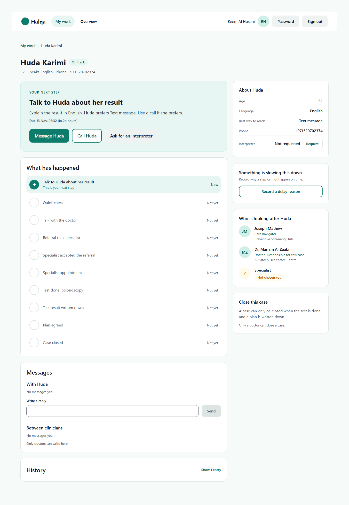

# Halqa

Halqa helps care teams follow an actionable screening result through to a documented outcome. It shows who owns the next step, what is overdue, what the patient has been told, and what evidence supports closing the case.

**[Open the live Halqa demo](https://halqa-hackathon.vercel.app)** · **[Download the 2:50 walkthrough (MP4)](https://raw.githubusercontent.com/karakaraye/Halqa/main/docs/demo/Halqa-Hackathon-Demo.mp4)**

## Sign in and explore

All five accounts use the password **`Password1234`**. Open the live app, enter one of the emails below, and select **Sign in**.

| Role | Email | What to try first |
|---|---|---|
| Care navigator | `nav_reem@halqa.test` | Open **My work**, choose a case, and review who owns the next step. |
| Primary care doctor | `pcp_mariam@halqa.test` | In **My work**, open a case to review the consultation, referral, and closure requirements. |
| Receiving specialist | `sp_tariq@halqa.test` | Open **Referrals** to see what was sent and how the receiving team responds. |
| Patient | `patient_hq-1003@halqa.test` | The portal opens in Hindi. Choose **English** from the language menu at the top to find **Your result** and **Your steps**. |
| Clinic lead | `lead_fatima@halqa.test` | Start at **Overview** for programme activity, then open **Approvals** for any cases that need a second check. |

Use **Sign out** before switching roles. To compare roles side by side, sign in from separate browser profiles. The site uses shared synthetic cases, so another reviewer’s actions can change what you see. Account changes are disabled to keep these logins available. The first load can take a moment if the demo has been idle.

The patient account opens **Priya Nair (HQ-1003)**. The live examples and the video’s **Layla Demo** case are separate. Each staff account sees the cases available to its role.

To compare a handoff across two roles, look for **Sultan Al Mansoori (HQ-1002)** in the doctor’s **My work** and the specialist’s **Referrals**. Review the referral on both sides before taking an action if you want to leave it available for the next reviewer.

## What Halqa solves

A screening result can pass from a lab to a navigator, a referring doctor, a receiving service, and back to the patient. At each handoff, someone needs to know who acts next and whether that step actually happened. Halqa puts those decisions in one case timeline. It tracks patient contact, records the patient’s understanding, shows whether the receiving team accepted the referral, and requires evidence before a clinician closes the case.

The demo includes colorectal FIT, breast imaging, cervical HPV, and diabetes HbA1c screening pathways. Each has its own follow-up steps and timing. The walkthrough follows a positive FIT result through specialist assessment.

## Follow the walkthrough

1. **Result arrives.** A synthetic lab result creates a case, assigns the care team, and gives the navigator a next action.
2. **Patient is contacted.** The navigator records reaching the patient. The patient portal then shows the result, what it means, and a short check of the patient’s understanding.
3. **Doctor refers and specialist responds.** The doctor documents the consultation and sends a referral to a receiving service. The specialist reviews it and can accept it or send it back with a reason.
4. **Appointment and outcome are recorded.** The care team books the visit and records attendance. The specialist documents the test result and the follow-up plan. The patient sees booking and progress in **Your steps**.
5. **Clinician closes the loop.** The doctor records the outcome, links the closure to supporting evidence, and confirms the plan. An exception closure without a test, such as when the patient declines, goes to the clinic lead for a second check.

The video follows one case from intake to completion. The live app includes cases at different stages, and the patient login opens its own linked case. To explore a particular handoff, choose a case at that stage and look for its timeline under **What has happened**.

Video chapters: **0:00** result intake · **0:37** patient result · **1:02** referral · **1:28** booking · **2:19** clinician closure · **2:34** patient completion.

## What to look for in the live app

| Review question | Where to look |
|---|---|
| Who owns the next step? | Open a staff case. The case header and care-team panel show who is responsible, and the timeline shows what has happened. |
| What does the patient understand and see? | Sign in as the patient. Compare **Your result**, **Your steps**, and **Help** with what staff see on the case timeline. |
| Did the referral reach the receiving service? | Compare the doctor’s case timeline with **Referrals** in the specialist account. A returned referral includes a reason for the referring team. |
| What evidence supports closure? | Open a care-team case near closure and review the outcome, evidence reference, plan, and recorded decision. |
| How does the lead review the programme? | Use **Overview** to review progress and **Approvals** to see any pending exception closures. |

The patient portal offers English, Arabic, Hindi, and Urdu, with a right-to-left layout for Arabic and Urdu. The live demo is for evaluation with synthetic data. Use fictional names and contact details if adding anything during review.

## More about Halqa

- [Product overview](docs/product-overview.md) explains the problem, what Halqa covers, and what a pilot would measure.
- [Role-by-role user guide](docs/user-guide.md) explains what to look for on each screen.
- [Video file in this repository](docs/demo/Halqa-Hackathon-Demo.mp4) is available if the direct download does not open in your browser.
