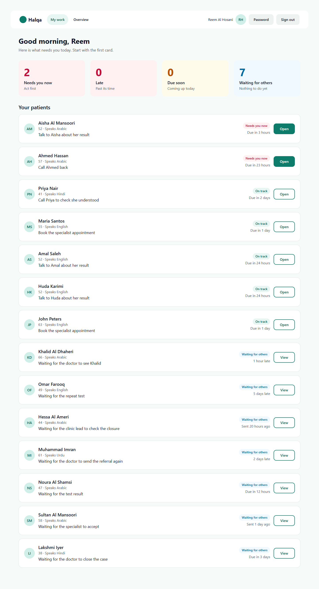
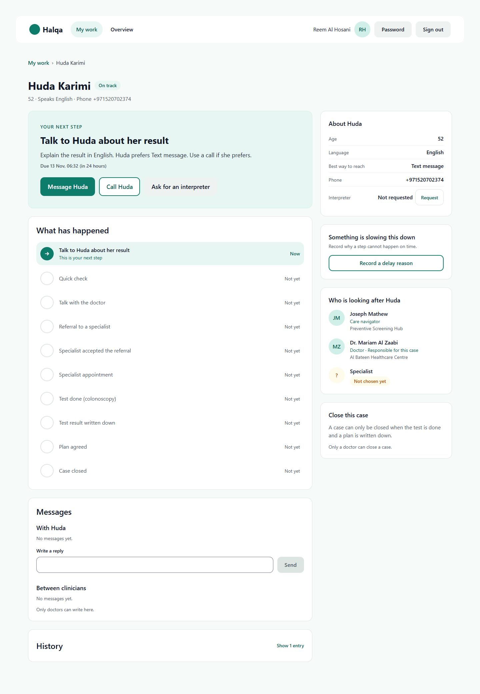
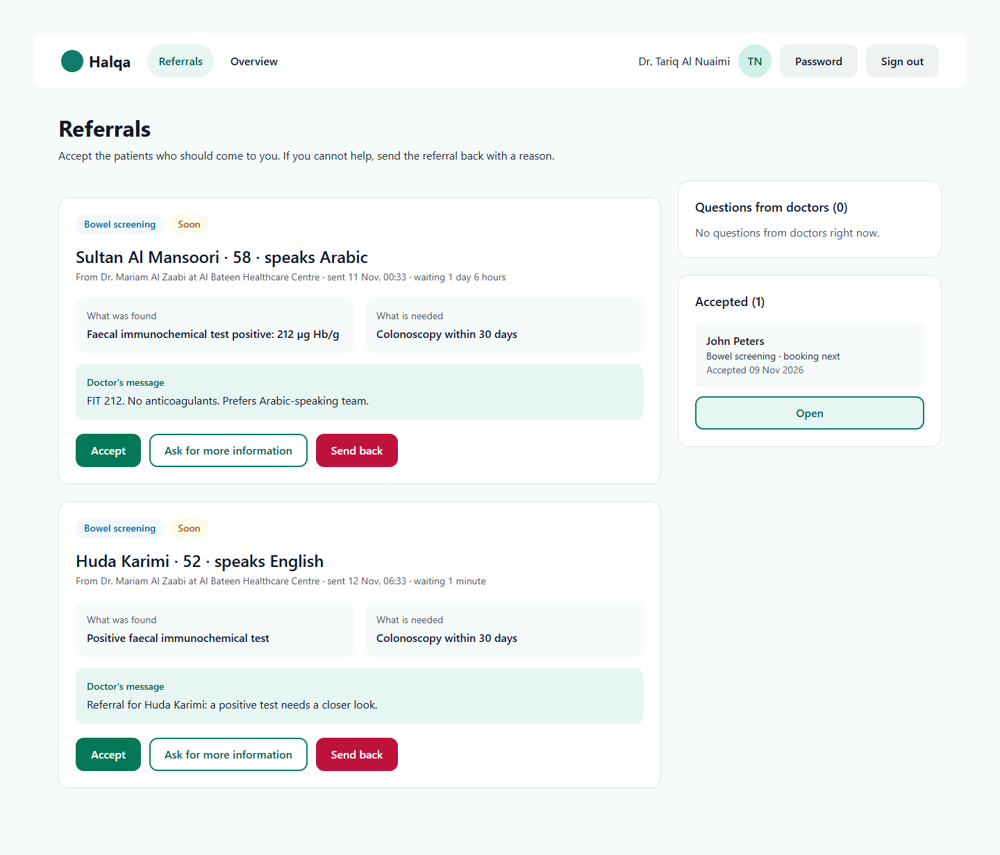
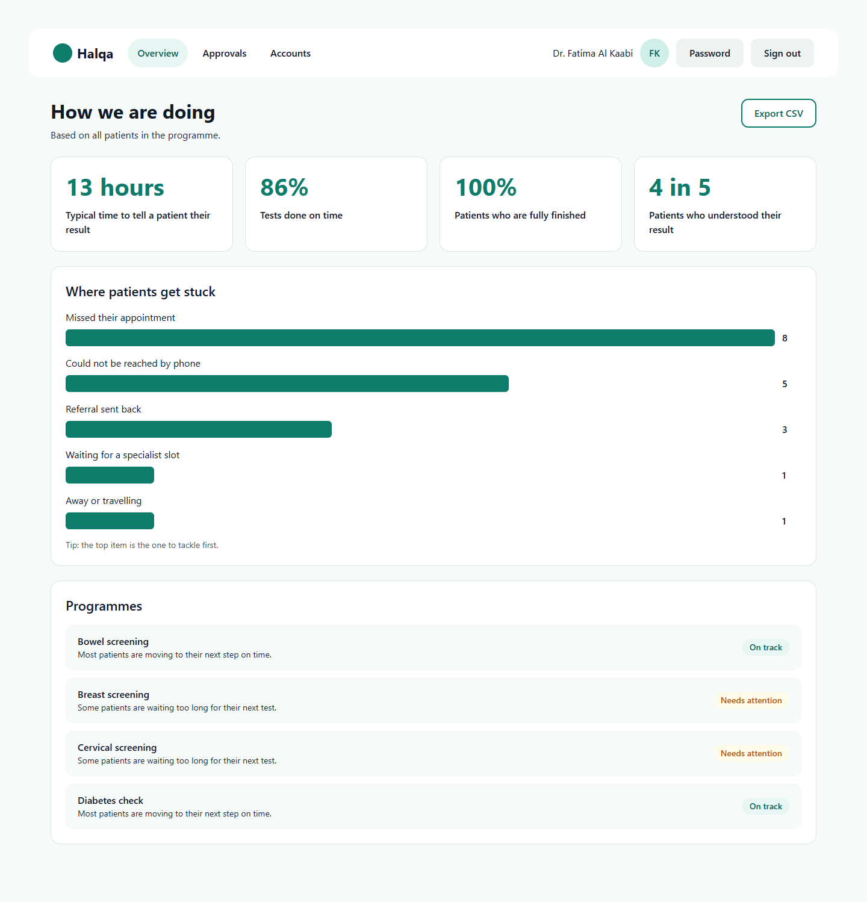
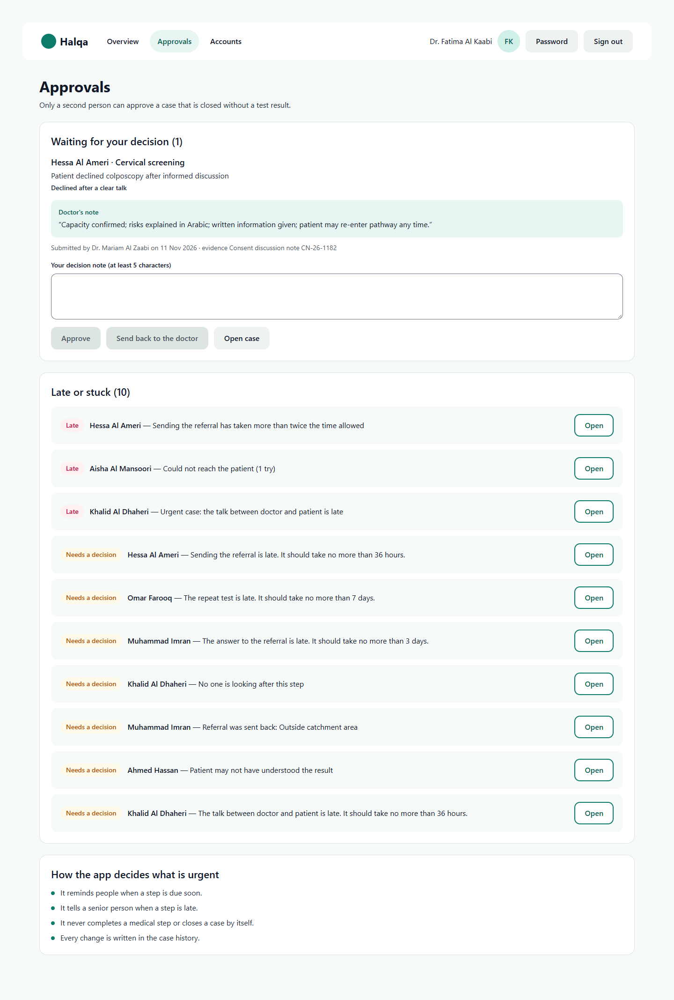
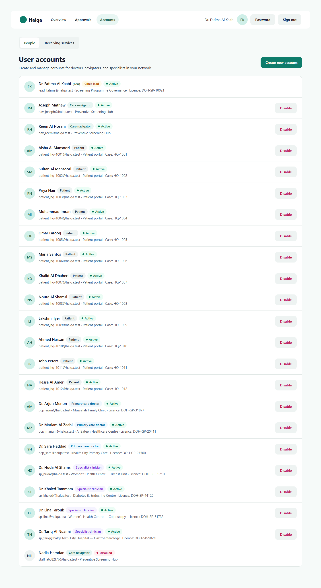
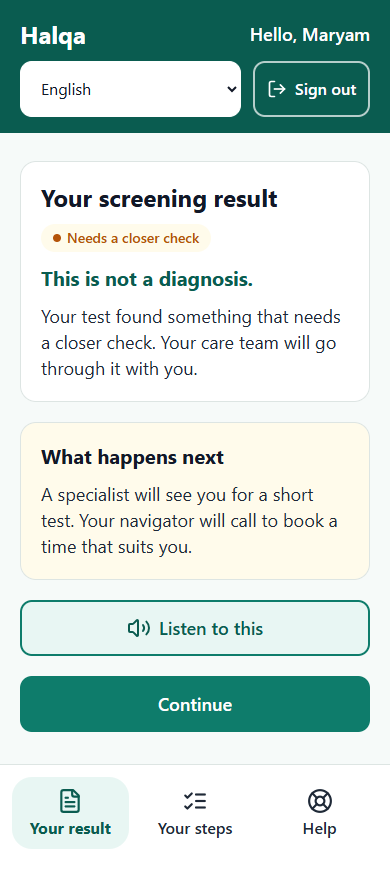
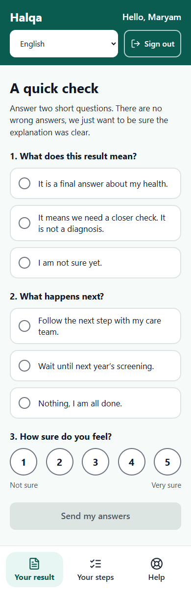
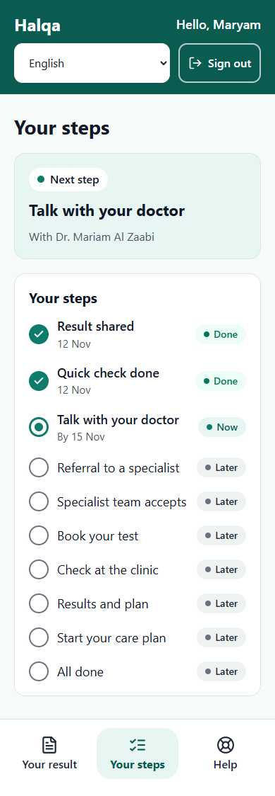
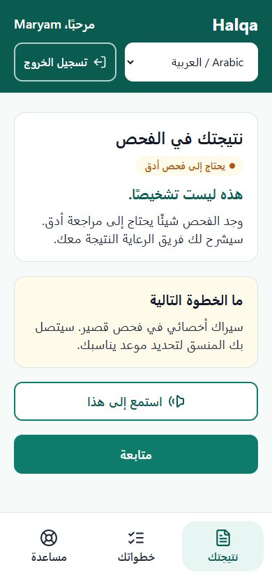

# Halqa (حَلْقَة) — closing the screening-to-care loop

Halqa makes sure a screening result turns into care. Every actionable result becomes one **case** with a named owner, a clock, a next step the patient understands in their own language, and a closure that a licensed clinician signs with evidence. Nothing is "sent and forgotten": if a step is late, someone is told; if a referral is refused, it comes back to the referring doctor; a case can only be closed against clear rules.

The name means "the loop" in Arabic.

## Contents

1. [Project status and verification](#1-project-status-and-verification)
2. [The problem and the approach](#2-the-problem-and-the-approach)
3. [Key ideas in plain words](#3-key-ideas-in-plain-words)
4. [Care programmes, steps and time targets](#4-care-programmes-steps-and-time-targets)
5. [People, roles and what each can do](#5-people-roles-and-what-each-can-do)
6. [The screens](#6-the-screens)
7. [How a result becomes care](#7-how-a-result-becomes-care)
8. [Architecture](#8-architecture)
9. [Quick start](#9-quick-start)
10. [Connecting your systems](#10-connecting-your-systems)
11. [Going live](#11-going-live)
12. [Configuration](#12-configuration)
13. [Scripts](#13-scripts)
14. [HTTP routes](#14-http-routes)
15. [Security model](#15-security-model)
16. [Testing and quality gates](#16-testing-and-quality-gates)
17. [Project structure](#17-project-structure)
18. [Languages, accessibility and design](#18-languages-accessibility-and-design)
19. [Troubleshooting](#19-troubleshooting)
20. [Known limits](#20-known-limits)
21. [Documents](#21-documents)
22. [Contributing and licence](#22-contributing-and-licence)

---

## 1. Project status and verification

The software is complete for a first release and verified. What remains before real patients are served is the list of people-and-contract tasks in **[`docs/go-live-checklist.md`](docs/go-live-checklist.md)**: clinical approval of the care programmes, certified translations, a message provider, a result-intake agreement with the laboratory, privacy and legal review, hosting and backups, independent security and accessibility checks, usability testing and a pilot agreement. Code cannot finish those.

Checks run on the release tree (13 November 2026, from a clean `npm ci`). Dated records and the written comparison with the design are in [`VERIFICATION.md`](VERIFICATION.md).

| Check | Result |
|---|---|
| `npm run typecheck` | passes, no errors |
| `npm run lint` | passes, no errors or warnings |
| `npm test` | 117 of 117 unit, security and operations tests pass |
| `npm run secrets-scan` | no findings |
| `npm run build` | passes |
| `npm run test:e2e` | 32 of 32 browser tests pass, in two runs |
| `npm audit --omit=dev` | 0 vulnerabilities. The 7 moderate findings in development tooling are explained in [`docs/security.md`](docs/security.md) |
| Load check (`npm run load-check`: 5 minutes, 50 signed-in clients, 2,000 open cases) | p50 24 ms, p95 140 ms, p99 305 ms, 0 errors (development machine) |

Passing tests prove only what they exercise. Nothing here is a clinical validation, a penetration test or an accessibility audit by an outside reviewer.

---

## 2. The problem and the approach

Issuing a result does not show that the patient understood it, that a specialist accepted the referral, that the appointment happened, or that care followed. Records are split between laboratories, clinics and hospitals, and nobody owns the gap between them. Results go quiet, and no one can say how many are unresolved or who is responsible for each.

Halqa's approach, in five rules:

1. **Every result is visible.** One case per actionable result, followed from the day it was issued to the day it is closed.
2. **Every step has one owner and one clock.** A hand-over only counts once the receiver accepts it.
3. **Every patient understands.** The patient is told in their preferred language, with no diagnosis in the message, and answers a short understanding check. If they are unsure, a person calls.
4. **Every referral is acknowledged.** A specialist service accepts it or sends it back with a reason. A refusal returns to the referring doctor and cannot disappear.
5. **Every closure is evidenced.** A licensed clinician signs it with a result reference and a plan. Closing without a test result needs a second, different licensed person.

The system **alerts people and never decides for them**: it never completes a clinical step or closes a case by itself.

Halqa does not replace the patient record or the laboratory system. It receives results, tracks what happens next, and shows who must act.

---

## 3. Key ideas in plain words

| Term | Meaning |
|---|---|
| **Case** | One actionable screening result and everything that follows it. Ids look like `HQ-1042`. |
| **Care step** | One stage on the way to care (told, understood, consulted, referred, accepted, booked, attended, result recorded, plan started, closed). Each has an owner role and a time target. |
| **Owner** | The role or person who must act on the current step. Shown on every case. |
| **Accountable doctor** | The one doctor who answers for the case from start to finish. Changed only by an accepted hand-over. |
| **Urgency** | `CRITICAL`, `ELEVATED` or `ROUTINE`. It scales every time target: critical cases get half the time, routine cases one and a half times. |
| **Time target** | How long a step should take. A step past its target is "late". |
| **Alert** | The system telling a person that something needs a decision (a late step, a refused referral, a patient who may not have understood). Alerts never act. |
| **Hand-over** | Passing a patient to another doctor or specialist. The current holder stays responsible until the other person accepts. |
| **Closure** | The signed end of a case. **Standard** closure needs the test result and a plan. **Exception** closure (the patient said no after a clear talk, care completed elsewhere, the patient moved away) needs a second approval. |
| **Network** | One organisation's whole set of staff, patients and cases. People only ever see their own network. |
| **Directory** | The staff list and receiving services of a network. It lives in the database: staff are managed on the Accounts screen, receiving services through the clinic lead's service routes (section 14). |
| **Outbox** | Patient messages waiting to be sent. A message is only counted as delivered when the message service reports it. |

---

## 4. Care programmes, steps and time targets

Four programmes are built in. The steps, owners and time targets below are **working defaults in `src/lib/pathways.ts` that need clinical approval before use with patients** (see the go-live checklist).

Time targets are for an `ELEVATED` case. `CRITICAL` multiplies them by 0.5, `ROUTINE` by 1.5.

**Bowel screening (positive faecal test), breast screening (abnormal mammogram) and cervical screening (high-risk HPV or high-grade cytology)** share one set of ten steps:

| # | Step | Owner | Target |
|---|---|---|---|
| 1 | Patient notified | Care navigator | 24 hours |
| 2 | Understanding confirmed | Patient | 48 hours |
| 3 | Clinician consultation | Doctor | 72 hours |
| 4 | Referral sent | Doctor | 24 hours |
| 5 | Referral accepted | Specialist | 48 hours |
| 6 | Appointment booked | Specialist | 72 hours |
| 7 | Test performed | Patient | 14 days (bowel: colonoscopy), 7 days (breast: core biopsy), 14 days (cervical: colposcopy) |
| 8 | Result recorded | Specialist | 7 days |
| 9 | Treatment or surveillance started | Specialist | 14 days |
| 10 | Case closed and signed | Doctor | 72 hours |

Clinical target from result to test: bowel 30 days, breast 14 days, cervical 28 days.

**Diabetes check (HbA1c in the diabetes range)** has six steps, all within primary care:

| # | Step | Owner | Target |
|---|---|---|---|
| 1 | Patient notified | Care navigator | 48 hours |
| 2 | Understanding confirmed | Patient | 72 hours |
| 3 | Confirmatory HbA1c done | Doctor | 7 days |
| 4 | Clinician consultation | Doctor | 5 days |
| 5 | Treatment plan started | Doctor | 7 days |
| 6 | Case closed and signed | Doctor | 72 hours |

Clinical target from result to confirmation: 14 days.

### When the system raises an alert

| Alert | Raised when | Goes to |
|---|---|---|
| Step overdue | The current step passes its time target | The step owner and the coordination lead |
| Step seriously overdue | Twice the target, or any critical case that is overdue | The clinic lead, who must record a decision |
| No owner | A step has had no responsible person for more than 4 hours | The coordination lead |
| Patient unreachable | 3 failed contact attempts, or a failed message on a critical case | The clinic lead, who decides the other routes (family, home visit) |
| Referral sent back | The receiving service refuses or asks for more information | The referring doctor |
| Patient may not have understood | A wrong answer or low confidence (2 out of 5 or less) on the understanding check | The care navigator, who calls in the patient's language |
| Missed appointment | The patient misses the test (the second miss is escalated) | The care navigator and the specialist scheduler |

A closure waiting for second approval has its own deadline and keeps being monitored.

### What a standard closure needs

Among other checks, the server refuses a standard closure unless: the person closing is a doctor or specialist with a recorded licence; every required step is complete; a result is recorded; a care plan is recorded; a result reference and a plan are written; and no serious alert is still open. An exception closure needs a written reason of at least 30 characters and is approved by a **different** licensed clinic lead. These rules live in `src/domain/closure.ts` and are enforced by the server, not only by the buttons on screen.

---

## 5. People, roles and what each can do

| Role | Who | Sees |
|---|---|---|
| **Care navigator** | Keeps cases moving: calls patients, books, chases | Every case of their own care hub (navigators in one hub share a queue and can cover for each other) |
| **Doctor** (`PCP`) | Decides the next step, refers, closes cases | Cases of their own clinic, and cases they are accountable for |
| **Specialist** | Accepts or sends back referrals, records the test result and plan | Cases at the receiving services they answer for, and cases they hold |
| **Clinic lead** | Approves exceptions, watches progress, manages accounts and services | Every case in the network |
| **Patient** | Their own result, steps and help | Only their own released journey and the messages meant for them |

Anyone with a hand-over waiting for them can also see that case.

### What each role can do

| Action | Navigator | Doctor | Specialist | Lead | Patient |
|---|---|---|---|---|---|
| Tell the patient (message or phone call) | Yes | Yes | | | |
| Record a phone understanding check, finish a call-back | Yes | Yes | | | |
| Answer the understanding check, ask for a call back | | | | | Yes |
| Ask for an interpreter | Yes | Yes | | | Yes |
| Record consultation, confirmation test | | Yes | Yes | | |
| Send or re-send a referral | | Yes | | | |
| Accept, ask about, or send back a referral | | | Yes | | |
| Book an appointment | Yes | Yes | Yes | | Yes (own, when offered) |
| Record attendance | Yes | Yes | Yes | | |
| Record a missed appointment | Yes | Yes | Yes | | |
| Record result and care plan | | Yes | Yes | | |
| Hand a patient over | | Yes | Yes | Yes | |
| Accept or decline a hand-over | Only the person it was offered to | | | | |
| Choose owners for a case | Yes | Yes | | Yes | |
| Note why something is slow, resolve an alert | Yes | Yes | Yes | Yes | |
| Close a case | | Yes | Yes | | |
| Approve or send back an exception closure | | | | Yes | |
| Message the patient | Yes | Yes | Yes | Yes | Replies only |
| Message between clinicians | | Yes | Yes | Yes | |
| Create and disable accounts (screen), and receiving services (routes only) | | | | Yes | |

The server enforces this table on every action. Screens only hide what the server would refuse. Staff cannot act as a patient, and a patient can only write to their own care team.

---

## 6. The screens

Screenshots are taken from the running application with local development records. Every screen is checked against the design at 1440 pixels and 390 pixels (patient screens at 390 and 320), with automated accessibility checks.

### Staff

| Screen | Who | Purpose |
|---|---|---|
| **My work** | Navigator, doctor | Four summary cards (needs you now, late, due soon, waiting for others) and every open patient with one clear next step and a status word |
| **Case page** | Staff on the case | The next step and its action, the full history of the case, patient summary, who is looking after the patient, messages (with the patient and between clinicians), decisions that need a person, "Something is slowing this down", interpreter requests, hand-over, and closing |
| **Referrals** | Specialist | Referrals waiting for a decision (accept, ask for more information, send back with a reason), questions from doctors, and accepted patients |
| **Overview** | Everyone | Measured figures: time to tell patients, tests on time, cases fully finished, patients who understood, where patients get stuck, and how each programme is doing. Export as CSV |
| **Approvals** | Clinic lead | Exception closures waiting for a second approval, things that are late or stuck, and how the system decides what is urgent |
| **Accounts** | Clinic lead | List accounts, create them (temporary password shown once) and disable them |

Tabs shown: navigator and doctor see My work and Overview; specialists see Referrals and Overview; the lead sees Overview, Approvals and Accounts. Everyone has Password and Sign out in the top bar.

<table>
<tr>
<td width="50%"><strong>My work</strong><br></td>
<td width="50%"><strong>Case page</strong><br></td>
</tr>
<tr>
<td width="50%"><strong>Referrals</strong><br></td>
<td width="50%"><strong>Overview</strong><br></td>
</tr>
<tr>
<td width="50%"><strong>Approvals</strong><br></td>
<td width="50%"><strong>Accounts</strong><br></td>
</tr>
</table>

### Patient (phone)

The patient signs in with the email and password a clinic lead created for them. They see only their own case, and only after the care team has told them about it.

| Screen | What the patient sees |
|---|---|
| **Waiting** | Shown until the result is released: "Your result is on its way" and a button to ask for a call |
| **Your result** | The result in plain words, always with "This is not a diagnosis", a listen-aloud button, and what happens next |
| **Quick check** | Two short questions and a confidence rating, so the team knows the explanation was clear. Scored on the server |
| **All done** | Confirmation that the answers were saved |
| **Your steps** | The next step and every step so far; a clear line when the navigator will call to book a time |
| **Booked** | The real appointment, with an "add to my calendar" file |
| **Help** | Ask for a call back, ask for an interpreter, send a message, see the care team |

<table>
<tr>
<td align="center"><strong>Your result</strong><br></td>
<td align="center"><strong>Quick check</strong><br></td>
<td align="center"><strong>Your steps</strong><br></td>
<td align="center"><strong>Arabic, right to left</strong><br></td>
</tr>
</table>

---

## 7. How a result becomes care

```text
Laboratory / record system
        │  POST /api/intake/results (integration key)
        ▼
 Case opens ──► navigator with the fewest cases + the named doctor are assigned
        │       the patient is NOT yet told
        ▼
 Navigator tells the patient ──► message goes to the OUTBOX (or a person phones)
        │                        the worker sends it to the message service
        │                        message service reports DELIVERED  ──►  step 1 complete,
        ▼                                                                 patient sees the result
 Patient reads the result, answers the quick check ──► scored on the server
        │     wrong answer or low confidence ──► alert: navigator calls
        ▼
 Doctor consults ──► sends referral to a receiving service
        │     refused or "need more information" ──► returns to the doctor, who re-routes
        ▼
 Specialist accepts ──► appointment booked ──► patient attends
        │     missed ──► alert, reason recorded, back to booking
        ▼
 Specialist records the result and the care plan
        ▼
 Doctor or specialist signs the closure with the result reference and plan
        │     exception (no test result) ──► waits for a different licensed lead
        ▼
 Case closed ── every action above is in the append-only history
```

At every step the screen shows who must act and how long they have. A background worker raises the alerts described in section 4.

---

## 8. Architecture

```text
 Browser (staff and patient screens, Next.js / React)
        │  poll every 3 s with If-None-Match, writes with a CSRF token
        ▼
 Next.js route handlers  (src/app/api/*)
        │  session check · origin check · rate limit · strict schema
        ▼
 Permission check  (src/server/permissions.ts, directory from the database)
        ▼
 Domain transition  (src/domain/*, no framework code)
        ▼
 SQLite transaction  (node:sqlite, WAL)
        └─ case record + audit event + retry receipt, committed together

 Worker (scripts/worker.ts, every 15 s)
        ├─ raises alerts for late steps
        ├─ sends queued patient messages to the message address
        └─ removes expired sessions, old receipts and expired limits
```

**Stack:** Next.js 16, React 19, Tailwind CSS 3, TypeScript, Zod for input checking, SQLite through Node's built-in `node:sqlite`. No external services are needed to run it.

**Data kept** (one SQLite file, schema changes are numbered steps applied once inside a transaction and tracked by `PRAGMA user_version`): users (staff and patient accounts), sessions, cases (one typed record per case), append-only events (the audit trail; the database refuses to update or delete them), command receipts, login limits, rate limits, the outbox (queued messages and delivery reports), services (receiving services), and workspace metadata.

**Concurrency:** every write carries the revision the user last saw; a stale write is refused with a clear message. The same request id never repeats the work, so a retry after a lost reply is safe. An unchanged workspace is answered with `304` before any case is read, so polling stays cheap.

**One server:** it is designed for one durable server with a local disk. Do not run it on temporary storage, an edge runtime, or as several unsynchronised copies. Growing past one server means moving persistence and coordination to a shared database ([`docs/architecture.md`](docs/architecture.md)).

---

## 9. Quick start

You need **Node.js 24 or later** (the backend uses Node's built-in SQLite module) and one machine with a writable, durable disk.

```sh
git clone https://github.com/karakaraye/Halqa.git
cd Halqa
git checkout release
npm ci
npm run setup -- --email you@yourclinic.org --name "Your Name" --org "Your Organisation"
npm run dev        # development server and worker on http://localhost:3000
```

What `setup` does: it creates the database and **only the first clinic lead account**. There are no cases and no other accounts. It prints a temporary password **once** and writes nothing to disk except the database. It refuses to run if any account already exists. Sign in with that email and password; you will be asked to choose a new password (at least 12 characters) before anything else. Then add everyone else from the **Accounts** screen, or from the terminal:

```sh
npm run user:create -- --email nurse@yourclinic.org --name "Navigator Name" --role NAVIGATOR --org "Care hub"
```

Roles are `NAVIGATOR`, `PCP`, `SPECIALIST`, `LEAD` and `PATIENT` (a patient account also needs `--patient-case`, the id of a case with no patient account yet).

To look around with ready-made local development records, use a **throwaway** database:

```sh
HALQA_DB_PATH=data/trial/halqa.sqlite npm run seed:local
HALQA_DB_PATH=data/trial/halqa.sqlite npm run dev
```

`seed:local` prints the account emails and their temporary password once, writes no file, and refuses to run when `NODE_ENV=production` or when `HALQA_ORIGIN` is an https address.

On **Windows**, double-click `Start Halqa.cmd`: it starts the app and worker when `data\halqa.sqlite` exists, and otherwise prints the setup command.

Production build:

```sh
npm run build
npm start
```

`npm run dev` and `npm start` both start the web server and the worker together (`scripts/serve.mjs`).

---

## 10. Connecting your systems

Halqa talks to two outside systems. Both use **integration keys**: a long random secret that the other system sends as `Authorization: Bearer <key>`. Halqa stores only the SHA-256 hash of each key.

### 10.1 Results arriving from the laboratory or record system

1. Make a key and its hash:

   ```sh
   node -e "console.log(require('crypto').randomBytes(32).toString('hex'))"
   node -e "console.log(require('crypto').createHash('sha256').update(process.argv[1]).digest('hex'))" "<the key>"
   ```

2. Put the **hash** in `HALQA_INTAKE_KEY_SHA256` and give the **key** to the laboratory system. While a key is being replaced you can list up to three hashes separated by commas.
3. The laboratory system posts each actionable result:

   ```sh
   curl -s -X POST https://halqa.example.org/api/intake/results \
     -H "Authorization: Bearer $KEY" -H "Content-Type: application/json" \
     -d '{"externalId":"LAB-000123","network":"halqa-network",
          "patient":{"id":"P-77","name":"Patient Name","age":54,"sex":"F","phone":"+10000000000","lang":"en","preferredChannel":"SMS"},
          "pathwayId":"CRC_FIT","finding":"Positive faecal immunochemical test","resultCode":"FIT+",
          "urgency":"ELEVATED","sourceLab":"Laboratory name","issuedAt":1789000000000}'
   ```

   A new result answers `201 {"caseId":"HQ-1042","created":true}`. Sending the same `externalId` again answers `200` with `created:false` and changes nothing, so the laboratory can safely retry.
4. The new case appears on the assigned navigator's **My work** within one poll, with a "new result" banner.

The patient is **not** marked as told when a case opens. A navigator does that, through the message outbox or a phone call.

### 10.2 Messages to patients

1. Choose a message provider and ask it to accept a JSON post from Halqa. Set `HALQA_MESSAGE_WEBHOOK_URL` (https only; plain http is allowed only to localhost) and `HALQA_MESSAGE_WEBHOOK_TOKEN`.
2. When a navigator sends a message, Halqa queues it. The worker posts it to your provider with the outbox id (also the idempotency key), channel, language, phone number and a template key. **It never contains a diagnosis or the result**; the patient receives a secure link.
3. Your provider reports the outcome to Halqa:

   ```sh
   curl -s -X POST https://halqa.example.org/api/intake/delivery \
     -H "Authorization: Bearer $DELIVERY_KEY" -H "Content-Type: application/json" \
     -d '{"outboxId":"msg_0000","status":"DELIVERED"}'
   ```

   Use a different key from the intake key, and put its hash in `HALQA_DELIVERY_KEY_SHA256`. `DELIVERED` completes the first care step and releases the result to the patient. `FAILED` records a failed attempt; repeated failures raise an alert to the care team.
4. If the webhook is not set, messages stay queued and nothing is sent. The case page says "Message is waiting to be delivered" until a report arrives; staff can phone the patient instead.

Full request and answer shapes are in [`docs/api.md`](docs/api.md).

---

## 11. Going live

Work through [`docs/go-live-checklist.md`](docs/go-live-checklist.md) for the people-and-contract items. For the technical side, in short (details, service files and the restore procedure are in [`docs/operations.md`](docs/operations.md)):

1. **Server:** one machine, Node 24, a durable local disk for `HALQA_DB_PATH`.
2. **First account:** `npm run setup -- --email ... --name ... --org ...`.
3. **Build with the production settings in the environment**, because some are fixed at build time: `HALQA_ORIGIN` (strict transport security) and `NEXT_PUBLIC_HALQA_TIME_ZONE` (every date on screen).
4. **Run** `npm start` under a service manager so it restarts. It runs the web server and the worker together.
5. **HTTPS:** put a reverse proxy with a TLS certificate in front. Set `HALQA_ORIGIN` to the exact public address, `HALQA_LISTEN_HOST=127.0.0.1` if the proxy is on the same machine, and `HALQA_TRUST_PROXY` to the number of proxies. **Without `HALQA_TRUST_PROXY`, every user behind the proxy looks like one address and shares the same request limits.**
6. **Backups:** schedule `npm run backup -- <directory>` (a consistent copy with SQLite `VACUUM INTO`) and practise a restore. Encrypt the disk or volume.
7. **Monitoring:** watch `GET /api/health` (200 `{"ok":true}`) and the JSON log lines on standard output (one line per failed or write request; no bodies, emails or phone numbers).
8. **Keys:** set the intake and delivery key hashes and the message address; plan how you will rotate them.
9. **Never** set `HALQA_TEST_CONTROLS` or run `seed:local` on a live service. Both refuse when `NODE_ENV=production`.
10. **Run the load check** on your own hardware: `npm run build`, then `npm run load-check`.

---

## 12. Configuration

Copy `.env.example` to `.env.local`. Every variable is described there and in `docs/operations.md`. None of the values in `.env.example` is a secret.

| Variable | Meaning |
|---|---|
| `HALQA_DB_PATH` | Path of the SQLite file (default `data/halqa.sqlite`) |
| `HALQA_ORIGIN` | Exact public origin with no trailing slash, for example `https://halqa.example.org`. Required when hosted: secure cookies, strict transport security, the only origin accepted on writes, and the sign-in link sent to patients. Set it when running `npm run build` too |
| `HALQA_INTAKE_KEY_SHA256` | SHA-256 of the key the laboratory system sends to `POST /api/intake/results` (up to three comma-separated hashes while rotating). Unset: that route answers 503 |
| `HALQA_DELIVERY_KEY_SHA256` | SHA-256 of the key the message service sends to `POST /api/intake/delivery`. Unset: 503 |
| `HALQA_MESSAGE_WEBHOOK_URL` | Where the worker posts queued patient messages. https only (http only to localhost). Unset: messages stay queued |
| `HALQA_MESSAGE_WEBHOOK_TOKEN` | Bearer token the worker sends to the message address. Put the real value only in `.env.local` |
| `PORT` | HTTP port (default 3000) |
| `HALQA_LISTEN_HOST` | Address the web server listens on, for example `127.0.0.1` behind a proxy on the same machine (default: every address) |
| `HALQA_TRUST_PROXY` | How many reverse proxies (1 to 5) add the caller's address to `X-Forwarded-For`. Unset or 0: the header is ignored and the connection's own address is used |
| `HALQA_SESSION_IDLE_MINUTES` | Minutes without a request before a session ends (1 to 480, default 30). Sessions always end 8 hours after sign-in |
| `NEXT_PUBLIC_HALQA_TIME_ZONE` | Time zone of every date on screen (an IANA name such as `Asia/Dubai`), read when the app is built. Unset: each browser's own time zone |
| `NODE_ENV` | `production` on a live service. Always refuses test controls and `seed:local` |
| `HALQA_TEST_CONTROLS` | Lets automated tests move the clock and settle messages at once. `1` = on. Refused in production. Never turn it on for a live service |
| `NEXT_TELEMETRY_DISABLED` | `1` stops Next.js usage reports (the launcher sets it) |
| `HALQA_E2E_PORT` | Port for the browser tests (default 3001) |

---

## 13. Scripts

| Script | What it does |
|---|---|
| `npm run dev` / `npm start` | Web server and worker together (`scripts/serve.mjs`). `dev` runs the development server; `start` runs the built app through `scripts/web.mjs` |
| `npm run build` | Production build |
| `npm run typecheck` | TypeScript check |
| `npm run lint` | ESLint (Next.js rules) over the project |
| `npm test` | Domain, security, permission, persistence, operations and secrets-scan tests |
| `npm run secrets-scan` | Scan every git-tracked file for keys, tokens and files that must not be committed; exits 1 on a finding |
| `npm run test:e2e` | Browser tests with their own database, on port 3001 or `HALQA_E2E_PORT`. Run `npx playwright install chromium` once |
| `npm run setup -- --email --name --org [--licence]` | Create the database and the first clinic lead |
| `npm run user:create -- --email --name --role --org [--licence] [--network] [--patient-case]` | Create one account with a temporary password shown once |
| `npm run seed:local` | Local development records on a throwaway database. Refuses production |
| `npm run backup -- <directory>` | Copy the database to `halqa-<UTC timestamp>.sqlite` |
| `npm run export-case -- <caseId> --out <file>` | One case, its history and queued messages as JSON, for a subject-access request. No password hashes |
| `npm run load-check -- [--duration <seconds>]` | Drive 50 signed-in clients against 2,000 open cases and report latency (run `npm run build` first) |

---

## 14. HTTP routes

Everything that is not a screen. Full bodies, answers and examples are in [`docs/api.md`](docs/api.md).

| Route | Caller | Purpose |
|---|---|---|
| `GET /api/health` | none | 200 `{"ok":true}` after a database read; 503 if it fails |
| `POST /api/intake/results` | integration key | Open one case for one laboratory result (idempotent on network + `externalId`) |
| `POST /api/intake/delivery` | integration key | The message service reports `DELIVERED` or `FAILED` for a queued message |
| `POST /api/session` | none | Sign in |
| `GET /api/session` | signed in | Who am I (and whether a new password is required) |
| `DELETE /api/session` | signed in | Sign out |
| `POST /api/session/revoke-all` | signed in | Sign out everywhere (every device) |
| `POST /api/account/password` | signed in | Change password (12 characters or more) |
| `GET`, `POST /api/admin/users` | clinic lead | List accounts; create one with a temporary password shown once |
| `POST /api/admin/users/{id}/disable` | clinic lead | Disable an account and end its sessions |
| `GET`, `POST /api/admin/services` | clinic lead | List and create receiving services |
| `POST /api/admin/services/{id}/disable` | clinic lead | Disable a receiving service |
| `GET`, `POST /api/workspace` | signed in | The route the screens use: read a snapshot (with `ETag`/`304`), or send one action |

Writes by signed-in users need the session cookie, an `x-halqa-csrf` header and an `Origin` that matches `HALQA_ORIGIN`. While an account still has a temporary password, every route except reading the workspace, reading the session, changing the password, signing out and signing out everywhere answers `403 Set a new password to continue.`

---

## 15. Security model

| Area | What is done |
|---|---|
| **Passwords** | Salted scrypt. A temporary password must be changed before any write. New passwords need 12 characters or more |
| **Sessions** | Random tokens, stored only as hashes. Cookies are `HttpOnly`, `SameSite=Strict`, and `Secure` when `HALQA_ORIGIN` is https. A session ends after an idle period (default 30 minutes), after 8 hours, on sign-out, on sign-out everywhere, when the password changes, and when the account is disabled |
| **Writes** | Need a valid session, a CSRF token (compared in constant time) and an allowed origin. Then a strict schema, a per-role permission check against the database directory, and one transaction that also writes an append-only audit record |
| **Repeat safety** | The same request id never repeats the work. Stale edits are refused |
| **Patients** | Receive only their own released journey. Messages never contain a diagnosis |
| **Limits** | Sign-in is limited per email and client (8 wrong attempts, then 15 minutes), and per client across emails (100 per 15 minutes). Intake, delivery, password and admin routes have their own per-client limits. The client address cannot be chosen by the caller (`HALQA_TRUST_PROXY`) |
| **Integration keys** | Only SHA-256 hashes are stored; compared in constant time; up to three accepted at once for rotation; never logged |
| **Outgoing messages** | Only to the configured https address; no redirects followed; 5-second timeout; retried up to five times, then marked failed |
| **Page policy** | Every page response gets its own script nonce (`script-src 'self' 'nonce-…' 'strict-dynamic'`), no framing, no eval; JSON routes get a policy that allows nothing. Frame blocking, referrer policy, content-type and permissions headers on every response; strict transport security on https |
| **Logs** | One JSON line per failed or write request with time, route pattern, method, status and error name. No bodies, emails, tokens or phone numbers |
| **Audit** | Sign-in, sign-out, lock-out, session revocation, account and service changes, and every clinical action are recorded. The database refuses to change or delete audit rows |
| **Secrets** | `npm run secrets-scan` checks every tracked file; the CI workflow runs it |
| **Dependencies** | `npm audit --omit=dev` reports nothing. A weekly CI job re-checks |

The review findings, the threat model and the incident steps are in [`docs/security.md`](docs/security.md). Personal data, retention and subject-access requests are in [`docs/data-protection.md`](docs/data-protection.md). **Report a security problem privately to the operator of your installation; do not open a public issue.**

---

## 16. Testing and quality gates

Run all of these before every change is accepted:

```sh
npm run typecheck
npm run lint
npm test
npm run secrets-scan
npm run build
npm run test:e2e        # once: npx playwright install chromium
```

| Suite | What it covers |
|---|---|
| **Unit and security tests** (`tests/`, 117 tests, well under a minute) | Closure and approval rules, permissions per role, patient projection, sign-in and lock-out, sessions (idle, revoke), forced password change, rate limits and proxy spoofing, intake (keys, validation, idempotence), outbox and delivery reports (retries, webhook rules), directory checks, server-side scoring, concurrency and retries, snapshots do not write, `ETag`/`304`, setup, backup, export, logging without secrets, secrets scan |
| **Browser tests** (`e2e/`, 32 tests, 4 to 9 minutes) | Sign-in and forced password change; account creation and disabling; every role's tabs and landing page; the whole care path through the screens (intake, call, quick check, consult, referral, accept, booking, attendance, result, plan, closure); send back and re-route; low understanding and the navigator's call; hand-over accepted and declined; exception closure approved and sent back; message delivery; sign-out leaks, safe retries, offline, "not on your list"; axe accessibility checks on **every screen and dialog** at two widths with colour contrast on; keyboard-only use and focus trapping |
| **Load check** (`npm run load-check`) | 50 signed-in clients, 2,000 open cases, 5 clients saving: latency percentiles and error counts |

The browser tests use their own database and ports. They write screenshots into `docs/design/compare/` only when `SAVE_SCREENSHOTS=1` is set. The continuous-integration workflow (`.github/workflows/ci.yml`) runs every gate on each push and a weekly dependency audit.

---

## 17. Project structure

```text
src/
  domain/                 Closure rules, intake, delivery, directory, teach-back scoring and workflow
                          transitions. Pure code: no framework, no database.
  server/                 Database and migrations, accounts, sign-in and sessions, permissions, command
                          schemas, snapshots, outbox and delivery, intake, rate limits, page policy,
                          maintenance (cleanup), test controls
  proxy.ts                Per-response script nonce and Content-Security-Policy
  app/
    api/                  health, session (+ revoke-all), account/password, workspace,
                          intake/results, intake/delivery, admin/users, admin/services
    page.tsx layout.tsx   The single page and its shell
  shared/protocol.ts      Shapes shared by the server and the screens
  context/                HalqaStore: sign-in, polling, safe retries, offline handling
  components/
    design/               Buttons, cards, dialogs, top bar, sign-in, password change
    staff/                My work, case page, referrals, overview, approvals, accounts
    patient/              Waiting, result, quick check, all done, steps, booked, help
  lib/                    Programmes and time targets (pathways), rules engine, patient copy
                          (English, Arabic, Hindi, Urdu), time zone helper, FHIR export,
                          local development records
  types/                  Domain types
scripts/                  setup, create-user, seed-local, backup, export-case, load-check,
                          secrets-scan, serve (launcher), web (server), worker
tests/                    Unit and security tests
e2e/                      Browser tests and helpers
docs/                     Guides (below) and the exported design frames in docs/design/
.github/workflows/        Continuous integration
```

---

## 18. Languages, accessibility and design

- **Languages:** the patient portal is available in English, Arabic, Hindi and Urdu, with right-to-left layout for Arabic and Urdu. The patient's name is isolated so mixed-direction text stays correct. **Hindi and Urdu wording is unreviewed and needs a certified medical translator before patient use**; the Arabic and English wording should be reviewed the same way.
- **Plain language:** screens avoid jargon (no "SLA", "escalation" or "custody"); a result screen always says "This is not a diagnosis"; every status has a word as well as a colour.
- **Accessibility:** controls are at least 48 pixels high (56 on patient screens), text is never smaller than 14 pixels, every control has a label, dialogs trap and return focus, focus is always visible, reduced motion is respected, and automated checks (WCAG 2.1 A and AA, including colour contrast) run on every screen and dialog. This is not a substitute for an audit by an outside accessibility reviewer.
- **Design:** the exported design frames are in `docs/design/`; [`docs/design-handoff.md`](docs/design-handoff.md) records the colours, type sizes, status words, who sees which tab, and every place the finished screens differ from the drawings, with the reason.
- **Time:** all dates use one configurable time zone (`NEXT_PUBLIC_HALQA_TIME_ZONE`), or each browser's own if unset.

---

## 19. Troubleshooting

| Symptom | Likely cause and fix |
|---|---|
| `npm run setup` says accounts already exist | Setup only runs on an empty database. Add people from the Accounts screen or `npm run user:create` |
| `npm run seed:local` refuses | `NODE_ENV` is `production` or `HALQA_ORIGIN` is an https address. It is for throwaway local databases only |
| "Set a new password to continue." | The account still has a temporary password. Sign in on the screen and choose a new password of 12 characters or more |
| Signed out unexpectedly | Idle for more than `HALQA_SESSION_IDLE_MINUTES`, 8 hours since sign-in, the password was changed, "sign out everywhere" was used, or the account was disabled |
| Intake returns `503` | `HALQA_INTAKE_KEY_SHA256` is not set on the server |
| Intake returns `401` | The key sent does not match any hash in `HALQA_INTAKE_KEY_SHA256` |
| Intake returns `422` | A field is missing or wrong, `issuedAt` is more than 5 minutes ahead of the server clock, `pcpId` is not an enabled doctor of that `network`, or that network has no staff accounts |
| Messages stay "waiting to be delivered" | `HALQA_MESSAGE_WEBHOOK_URL` is unset or not https, the token is wrong, the worker is not running, or the provider has not reported to `POST /api/intake/delivery` |
| `429` for ordinary users | Behind a proxy without `HALQA_TRUST_PROXY`, everyone shares one address and one set of limits. Set it to the number of proxies |
| Late steps do not raise alerts | The worker is not running. `npm run dev` and `npm start` start it; alerts appear within about 15 seconds |
| Dates show in the wrong time zone | Set `NEXT_PUBLIC_HALQA_TIME_ZONE` and rebuild (it is read at build time) |
| Port 3000 is in use | Set `PORT` |
| Browser tests fail to start | Port 3001 is in use: set `HALQA_E2E_PORT`. Run `npx playwright install chromium` once |
| Strict transport security is missing in production | `HALQA_ORIGIN` must be set when you run `npm run build`, not only when you run the app |
| Offline banner on screen | The browser lost its connection. Save buttons are disabled with the reason and recover by themselves |

---

## 20. Known limits

- One server and one SQLite file. Do not run it on ephemeral storage or as several copies.
- The time targets and urgency rules in `src/lib/pathways.ts` are defaults and need clinical approval before use with patients.
- Arabic, Hindi and Urdu copy needs certified medical translation and patient testing.
- No laboratory system and no message provider is connected until the operator contracts them. Patients sign in with an email and password issued by a lead; there is no one-time-code sign-in, no self-service password reset and no two-step sign-in (a lead issues a new temporary password).
- The password hashing cost is below the latest published guidance because the recommended cost blocks the single server for about a second per sign-in (documented trade-off in `docs/security.md`).
- The load check was run on a development machine, not on production hardware.
- The FHIR export is an unvalidated outline, not a live integration.
- Appointment times are entered by staff; patients do not choose from offered slots.
- Receiving services are created and disabled through the clinic lead's routes (`/api/admin/services`); there is no screen for it yet.
- Seven moderate advisories exist in development-only linting tools, with no patched release; nothing from them ships (`docs/security.md`).

---

## 21. Documents

| Document | Purpose |
|---|---|
| [`docs/go-live-checklist.md`](docs/go-live-checklist.md) | What people and contracts must provide before real patients are served |
| [`docs/user-guide.md`](docs/user-guide.md) | Role-by-role user guide with screenshots |
| [`docs/operations.md`](docs/operations.md) | Hosting, services, HTTPS, backups and restore, monitoring, key rotation, upgrades |
| [`docs/api.md`](docs/api.md) | Every HTTP route with bodies, answers and examples |
| [`docs/security.md`](docs/security.md) | Threat model, controls, review findings, dependency audit, secrets scan, incident steps |
| [`docs/data-protection.md`](docs/data-protection.md) | Personal data held, who sees it, retention, subject-access requests |
| [`docs/architecture.md`](docs/architecture.md) | Architecture and requirement map |
| [`docs/product-overview.md`](docs/product-overview.md) | What the product is and who it is for |
| [`docs/design-handoff.md`](docs/design-handoff.md) | Design reference: tokens, screen-to-file map, content rules, differences from the drawings |
| [`VERIFICATION.md`](VERIFICATION.md) | Dated test and build evidence and the design comparison |

---

## 22. Contributing and licence

- Work on a branch. Before asking for a change to be accepted, run every gate in section 16; all must pass.
- Keep the server in charge of what is allowed; screens only hide what the server refuses.
- Keep wording plain, keep every status paired with a word, and keep text at 14 pixels or more.
- Every change comes with the test that proves it. Screens also need to be checked against the design at the widths in section 6.
- Never commit `data/`, `.env*` (except `.env.example`), credentials or test output. `npm run secrets-scan` will catch many mistakes, not all.

No licence file is included. Add one before sharing or reusing the code.
