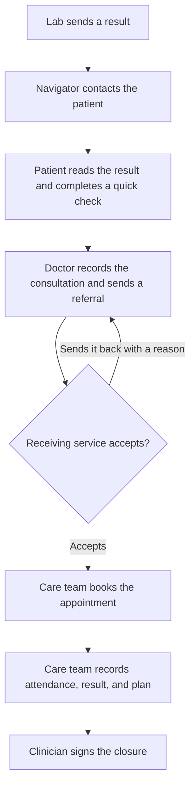

# Halqa

Halqa is a care coordination app for following up on actionable screening results. It gives each result a case, assigns the next step to a person, and shows the care team what is overdue. Patients can read their result once the team has made contact, answer a short understanding check, and see their appointment and next steps.


## How a case moves

The diagram shows the specialist route used for bowel, breast, and cervical screening. The diabetes pathway has its own primary-care follow-up steps. Each programme’s steps and time targets are defined in [the pathway configuration](src/lib/pathways.ts).



- **Care navigators** record contact attempts, arrange bookings, and follow up on missed appointments or low understanding.
- **Doctors** document consultations, refer to receiving services, and close cases with evidence.
- **Specialists** accept or return referrals and document test outcomes and next steps.
- **Clinic leads** monitor work across their network, review exception closures, and manage accounts and receiving services.
- **Patients** see their own released result, appointments, and care steps. The portal has English, Arabic, Hindi, and Urdu copy, with a right-to-left layout for Arabic and Urdu.

Regular closure requires a recorded result, a care plan, and evidence. An exception requires a documented reason and a decision by a different licensed clinic lead. Overdue work is escalated to staff for action.

[Role-by-role user guide](docs/user-guide.md) · [Patient portal screenshot](docs/design/compare/P1-result-390.png)

## Run the demo locally

Install **Node.js 24 or newer** and Git. The app uses Node’s built-in SQLite module and needs a writable local directory.

```sh
git clone https://github.com/karakaraye/Halqa.git
cd Halqa
npm ci
```

Seed an empty database with synthetic cases and accounts, then launch the app and worker.

**PowerShell**

```powershell
$env:HALQA_DB_PATH = 'data/demo/halqa.sqlite'
npm run seed:local
npm run dev
```

**Bash**

```bash
export HALQA_DB_PATH=data/demo/halqa.sqlite
npm run seed:local
npm run dev
```

Open [localhost:3000](http://localhost:3000). The seed prints the account details once. Sign in as `nav_reem@halqa.test` to open **My work**, or as `lead_fatima@halqa.test` to view **Overview**, **Approvals**, and **Accounts**. The terminal also lists patient accounts linked to individual seeded cases. The browser suite drives a complete synthetic result from intake through closure in [the shared-workflow test](e2e/shared-workflow.spec.ts).

For an empty installation with just one clinic lead, point `HALQA_DB_PATH` at a fresh file and run:

```sh
npm run setup -- --email lead@example.org --name "Clinic Lead" --org "Example Clinic"
npm run dev
```

`setup` prints a temporary password. The lead chooses a new one at first sign-in and can then add accounts and receiving services.

## How the app is organised

Halqa uses Next.js, React, and TypeScript. The staff workspace and patient portal use the same backend. The server checks a user’s role and case access, then applies permitted changes and records them in the audit history. The worker scans for overdue steps, handles queued messages when a provider is configured, and cleans up expired records.

| Directory | Contents |
| --- | --- |
| [`src/app/`](src/app) | Next.js pages and HTTP route handlers |
| [`src/components/`](src/components) | Staff workspace, patient portal, and shared interface components |
| [`src/domain/`](src/domain) | Workflow, closure, intake, directory, and patient understanding rules |
| [`src/lib/`](src/lib) | Pathway definitions, scheduling engine, translations, and synthetic fixtures |
| [`src/server/`](src/server) | SQLite, sessions, permissions, workspace updates, and integrations |
| [`scripts/`](scripts) | App launcher, worker, setup, backup, export, and load check |
| [`tests/`](tests) and [`e2e/`](e2e) | Unit and integration tests, plus browser workflows |
| [`docs/`](docs/README.md) | Product, architecture, interface, and operations documentation |

For integrations, the laboratory posts to `POST /api/intake/results`. Resending the same external result ID in the same network returns the existing case. Message providers use a separate key and report delivery to `POST /api/intake/delivery`. Until a message is delivered or staff record successful contact, the patient’s result stays in the waiting state. [API reference](docs/api.md)

## Verify changes

```sh
npm run typecheck
npm run lint
npm test
npm run secrets-scan
npm run build
npx playwright install chromium
npm run test:e2e
```

Playwright starts the built app on port 3001 by default and creates a separate test database. Set `HALQA_E2E_PORT` if that port is in use. For dated test results and screenshot comparisons, see [verification](VERIFICATION.md).

Keep role checks and clinical rules on the server when changing a workflow. For screen changes, run the relevant browser tests at desktop and phone widths. Keep databases, credentials, local environment files, and generated test output out of Git.

## Deployment and operations

- [Hackathon deployment](docs/hackathon-deploy.md) covers the hosted setup for synthetic data.
- [Operations](docs/operations.md) covers configuration, setup, backups, restore, and monitoring. Available environment variables are documented in [`.env.example`](.env.example).
- [Security](docs/security.md) and [data protection](docs/data-protection.md) cover access controls, incident reporting, retention, and exports. Report security concerns privately to the operator of the installation.
- [Go-live checklist](docs/go-live-checklist.md) covers the clinical approvals, translation review, privacy review, and operational checks required before using real patient data.

For the full system and interface references, see the [documentation index](docs/README.md).
