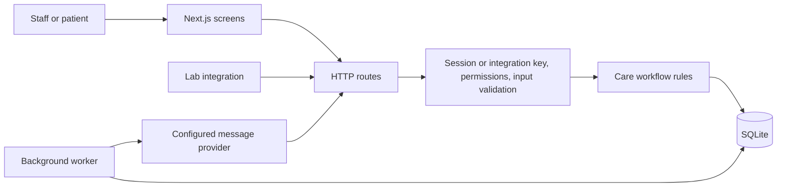

# Halqa — architecture and requirement map

## What the system does

Halqa coordinates screening follow-up across navigator, primary-care, specialist, clinic-lead and patient accounts. Staff are limited to the cases of their team, organisation or receiving service; the clinic lead sees the whole network. A patient sees only their own released journey, help requests and patient messages.

## Requirements and where each is met

| Requirement | How it is met |
|---|---|
| See every result from issue to closure | A lab or record system posts results to `POST /api/intake/results`; each actionable result opens one case. My work ranks open cases; the case page shows every care step, owner and history. |
| Clear ownership and timely progress | A named team, accepted hand-overs, receiving-service acceptance, overdue monitoring by the worker. |
| Patients understand and can ask for help | Results are released only after the patient is told; plain-language explanation; understanding check scored on the server; call-back, interpreter and messages. Messages wait in an outbox and a step completes only when the message service reports delivery (`POST /api/intake/delivery`). |
| Referrals are acknowledged across providers | Specialists accept, ask for information, or send back with a reason; the referring doctor sees the outcome. The staff directory and receiving services are rows in the database: staff are managed on the Accounts screen, receiving services on the same screen, in its Receiving services tab (the routes are `/api/admin/services`). |
| Humans decide, the system alerts | Closure rules in the domain; actual signed-in identity; a different licensed lead approves exceptions; clinical monitoring continues during approval. |
| Measure the outcome | The Overview computes measured figures from the cases; standard documented closure is separated from exceptions. No comparison figure is shown without real baseline data. |

## Architecture

The browser calls Next.js route handlers. The server validates the request and applies the workflow rules. Mutations write the case, audit event and retry receipt in the same SQLite transaction.

| Path | Responsibility |
| --- | --- |
| [`src/app/`](../src/app) | Next.js pages, global styles and HTTP endpoints |
| [`src/components/`](../src/components) and [`src/context/`](../src/context) | Staff and patient screens, workspace polling and UI state |
| [`src/server/`](../src/server) | Authentication, permissions, persistence, intake and outbox |
| [`src/domain/`](../src/domain) and [`src/lib/`](../src/lib) | Workflow rules, pathway definitions, metrics, translations and synthetic fixtures |
| [`src/shared/`](../src/shared) and [`src/types/`](../src/types) | Action and snapshot contracts and shared data types |
| [`scripts/`](../scripts), [`tests/`](../tests) and [`e2e/`](../e2e) | Service entry points, operations, automated checks and browser journeys |

Tables: users (staff and patient accounts), sessions, cases (typed JSON per case), append-only events, command receipts, login limits, rate limits, outbox (queued messages and delivery reports), services (receiving services of the directory), workspace metadata. Schema changes are numbered steps applied once, inside a transaction, tracked by `PRAGMA user_version`. Writes use WAL, a shared revision that refuses stale updates, and request ids that deduplicate retries. Case changes and their audit events commit together.

Browsers poll the workspace every three seconds and on focus, sending `If-None-Match`; an unchanged workspace is answered with 304 before any case is read. A separate worker checks the clock every 15 seconds, raises alerts for overdue steps, sends queued messages to the configured message address and cleans up expired sessions, receipts and limits.

Passwords use salted scrypt. A user with a temporary password must choose a new password before working on cases. Session tokens are random and stored as hashes. Session cookies are HttpOnly and SameSite Strict, and Secure over HTTPS. Sessions end on sign-out, password change, after eight hours, or after 30 minutes of inactivity by default. Browser workspace mutations require the session's CSRF token and an allowed origin. Sign-in attempts are limited per email and client address, and per client across emails.

Page policy: `src/proxy.ts` gives each page response its own script nonce in the Content-Security-Policy (`'strict-dynamic'`, no inline script without the nonce, no eval, no framing); JSON routes get a policy that allows nothing. Other security headers are set on every response (`next.config.js`).

The web server (`scripts/web.mjs`) serves the built app and replaces `X-Forwarded-For` with the connection address unless `HALQA_TRUST_PROXY` says how many proxies to trust. `scripts/serve.mjs` starts it with the worker.

The standard installation runs one server and worker against SQLite on a persistent disk. The [hackathon deployment guide](hackathon-deploy.md) covers temporary hosting for synthetic data. Use the [operations guide](operations.md) when planning an installation for real records.

## Operations

Health route (`GET /api/health`), consistent backups (`npm run backup`), one-case export for subject-access requests (`npm run export-case`), one JSON log line per failed or write request with no bodies or personal data, and a load check (`npm run load-check`) that drives 50 signed-in clients against 2,000 open cases. See [Operations](operations.md).

## Checks

`npm run typecheck`, `npm run lint`, `npm test`, `npm run secrets-scan`, `npm run build` and `npm run test:e2e`. See the [verification record](../VERIFICATION.md) for the scenarios tested and when they ran.

## Work that needs people

Clinical approval of pathways and timings, certified translations, a message provider, a lab or record-system agreement, privacy and legal review, hosting, an independent security test and accessibility audit, usability testing, and a pilot partner. The [go-live checklist](go-live-checklist.md) tracks the owner and evidence for each item.
