# Halqa User Guide

Halqa connects screening programmes with timely clinical follow-up across primary care, specialist clinics, and patients.

This guide explains everyday tasks for each role.

---

## 1. Getting Started

### Signing In
Staff sign in using their clinic email address and password at the sign-in screen.
- First-time sign in: If your account has a temporary password, Halqa will ask you to set a new password before you continue. Passwords must be at least 12 characters long.
- Password updates: You can update your password at any time with the **Password** button in the top bar.

### Your Workspace and Role Tabs
When you sign in, Halqa automatically opens your primary workspace:
- **Care Navigators and Primary Care Doctors:** Open to **My work** (`command`).
- **Specialists:** Open to **Referrals** (`specialist`).
- **Clinic Leads:** Open to **Overview** (`impact`).

Tabs are displayed clearly at the top:
- **My work:** Action-ranked cases needing attention.
- **Referrals:** Incoming and active specialist consultations.
- **Overview:** Clinic-wide performance and follow-up metrics.
- **Approvals:** Exception requests requiring two-person clinical review.
- **Accounts:** (Clinic Leads only) Staff directory, account creation, and credential management.

---

## 2. Care Navigator Guide

Navigators guide patients through screening results, assist with understanding, arrange interpretation, and ensure no patient is lost to follow-up.

### Reviewing Your Cases
The **My work** dashboard organizes cases into clear operational priorities:
- **Needs you now:** Patients requiring urgent outreach or unacknowledged screening results.
- **Late:** Steps that have exceeded their recommended clinical interval.
- **Waiting on other clinics:** Referrals awaiting specialist review.
- **Ready to close:** Completed pathways awaiting final clinician sign-off.

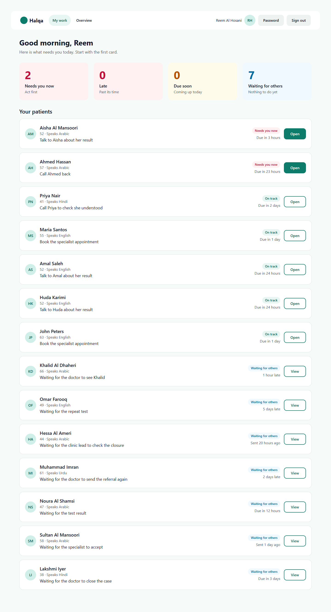

### Opening and Managing a Case
Click **Open** on any case card to open the case workspace. Dates and times are shown in the clinic's time zone, set with `NEXT_PUBLIC_HALQA_TIME_ZONE` (for example `Asia/Dubai`); when it is not set, the time zone of the browser is used.

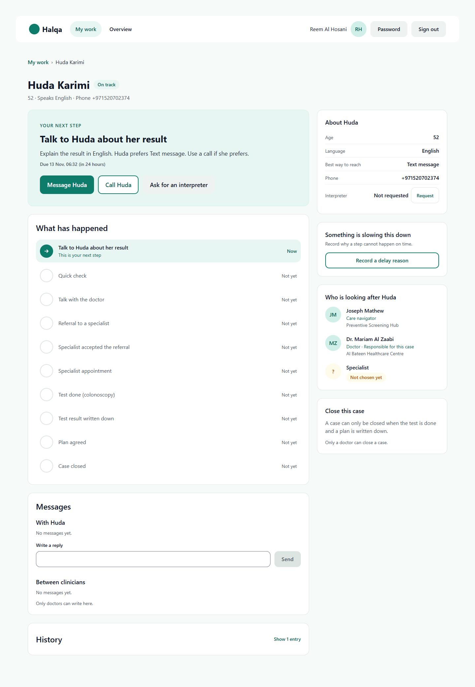

Key navigator actions on the case page:
1. **Your next step card:** Displays the immediate action required. The buttons depend on the step. **Mark as done** records a step that needs a note (the note box appears only for those steps). On the first step the main button is **Message <first name>**, because it queues a message for the patient. The case page then says "Message is waiting to be delivered" and the step is only done when the message service reports that it arrived (until then you can still phone the patient); **Call <first name>** records a phone call (reached or no answer). **Ask for an interpreter** records the request. When the specialist has accepted the referral, the card asks for the date and time of the appointment: type the real date and time agreed with the clinic. No times are suggested for you.
2. **About the patient:**
   - Displays patient contact information, preferred language, and clinical programme.
   - **Language interpreter request:** If the patient requires language support, click **Request** under Interpreter. Toggle **Turn off** once support is arranged or no longer needed.
3. **Recording delays ("Something is slowing this down"):**
   - Click **Record a delay reason**.
   - Select the cause:
     - *Could not reach the patient*
     - *Missed appointment*
     - *Specialist sent referral back*
     - *Clinic or hospital is busy*
     - *Patient had questions or needed more time*
     - *Patient wants to pause or decline*
     - *Patient is travelling*
     - *Waiting for records or test results*
   - Enter context in the optional note field and click **Save reason**. The reason is immediately visible to the entire clinical team.
4. **Patient callbacks:**
   - If a patient requests a phone call via their portal, an alert appears under **Needs you now**.
   - Once you have called the patient, record the callback and note any questions answered.

---

## 3. Primary Care Doctor Guide

Primary care physicians provide clinical consultations, place specialist referrals, review completed findings, and formally close completed screening pathways.

### Conducting Consultations
1. Open the patient's case from **My work**.
2. Review the screening result, history, and patient questions.
3. Record your consultation findings:
   - If no further specialist care is required, prepare the case for closure.
   - If specialist evaluation (e.g. colonoscopy, colposcopy, biopsy) is indicated, initiate a specialist referral.

### Referring to a Specialist
1. On the case page, select the required specialty service from the directory.
2. Enter the clinical reason for referral and any required priority.
3. Confirm the referral. The case immediately appears in the receiving specialist's **Referrals** inbox.

### Closing a Case with Verified Evidence
Halqa strictly enforces evidence-based pathway closure. A case cannot be closed on a checkbox alone.
1. Click **Close this case**.
2. Complete the mandatory clinical close requirements:
   - **Final clinical outcome:** Plain-language summary of findings (e.g. "Normal screening colonoscopy; routine re-screen in 10 years").
   - **Verifiable evidence reference:** Specific lab report, imaging identifier, or pathology record (e.g. "Pathology Report #P-88210, City Hospital").
   - **Follow-up care plan:** Clear schedule and instructions (e.g. "Return to routine national screening; primary care follow-up in 12 months").
   - **Clinician name and professional licence number:** Your full name and verified licence identifier.
3. Click **Confirm close**. The case is locked and archived into the permanent audit record.

### Requesting an Exception Close
If a patient declines further investigation or moves out of the catchment area:
1. Select **Request exception close**.
2. Provide the clinical reason and detailed evidence of counseling.
3. Submit for review. The case moves to **Pending approval** and alerts the Clinic Lead.

---

## 4. Specialist Guide

Specialists review incoming referrals, schedule procedures, document outcomes, and return care plans to primary care.

### Reviewing Incoming Referrals
1. Click the **Referrals** tab.
2. Review new referrals in the **Incoming** queue.

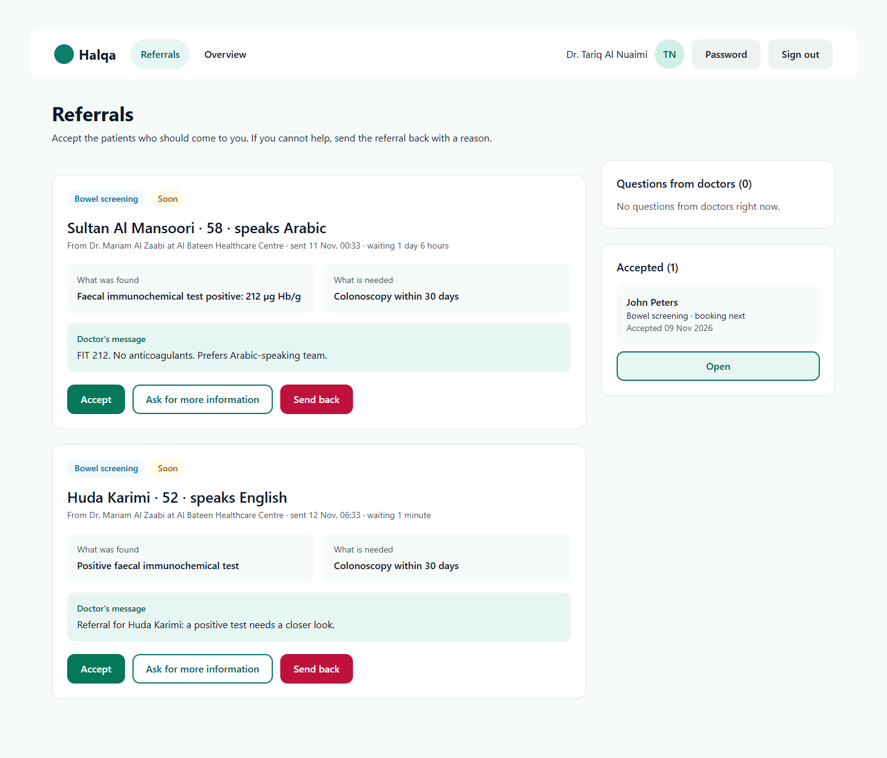

3. Actions:
   - **Accept referral:** Takes clinical custody of the consultation step and schedules the procedure.
   - **Send back with guidance:** If the referral lacks required prerequisites or is directed to the incorrect specialty, click **Send back**, select the reason, enter clinical guidance for the referring doctor, and click **Confirm send-back**.

### Documenting Attendance and Outcomes
1. Record when the patient attends the specialist appointment.
2. Document the procedure findings, outcome, and post-procedure care plan.
3. Send the completed report back to the primary care physician for final pathway closure.

---

## 5. Clinic Lead Guide

Clinic Leads oversee programme performance, review exceptions, and manage staff accounts.

### Monitoring Clinic Overview
The **Overview** dashboard provides real-time, tamper-proof tracking of all active screening pathways:
- **Active pathways:** Count of ongoing cases across screening programmes.
- **Median days to diagnostic resolution:** Time from abnormal screening result to confirmed clinical outcome.
- **Timely follow-up rate:** Percentage of patients reaching specialist care within programme benchmarks.
- **Closed with verified evidence:** Percentage of cases closed with verifiable diagnostic reports.

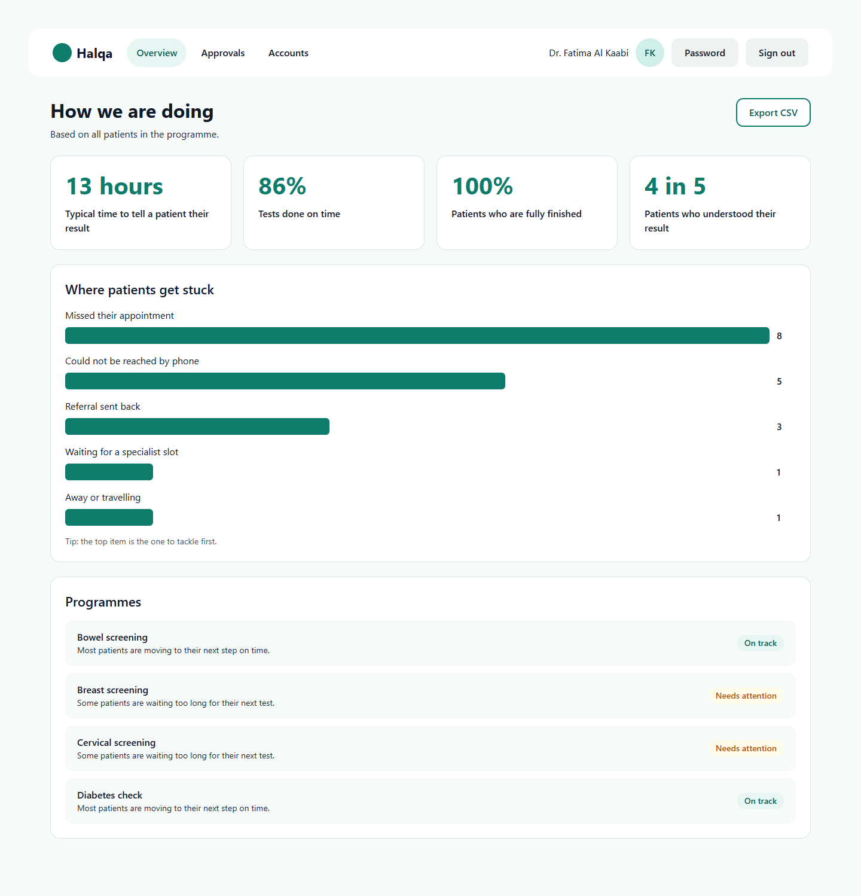

### Approving or Rejecting Exceptions
To maintain clinical safety, exceptions cannot be closed by a single clinician.
1. Open the **Approvals** tab.
2. Review pending requests.
3. Verify counseling notes and clinical reasoning.
4. Select **Approve exception** or **Send back for further counseling**.

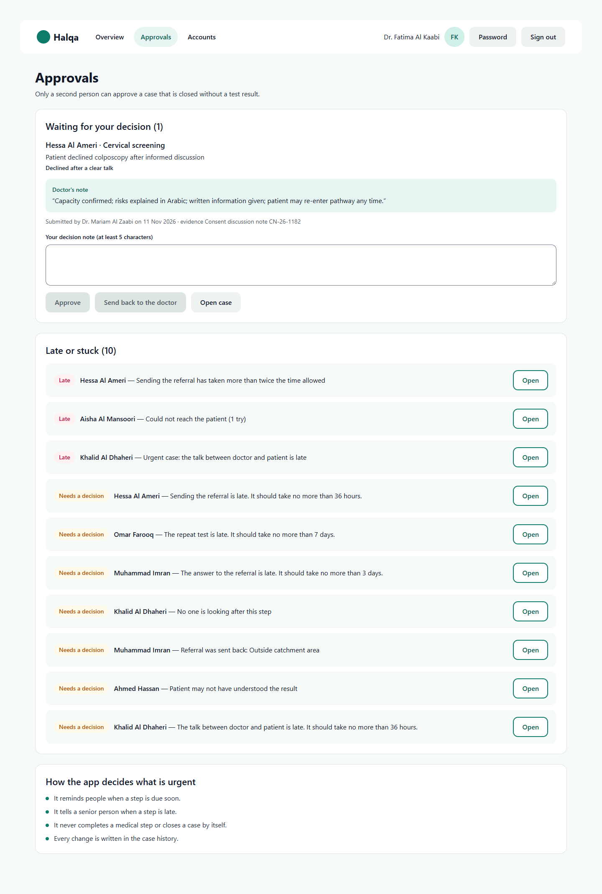

### Managing Staff Accounts
Clinic Leads manage staff accounts directly through the **Accounts** screen without database manipulation:
1. Open the **Accounts** tab.
2. **Review existing accounts:** View names, roles, emails, and account status (active or disabled).
3. **Add a new staff member:**
   - Enter name, email, and assign role (`NAVIGATOR`, `PCP`, `SPECIALIST`, `LEAD`).
   - Click **Create account**.
   - A one-time temporary password is generated. Share this securely with the staff member. They will be required to change it upon first sign-in.
4. **Disable accounts:** Click **Disable** next to any departing staff member to immediately revoke session access.

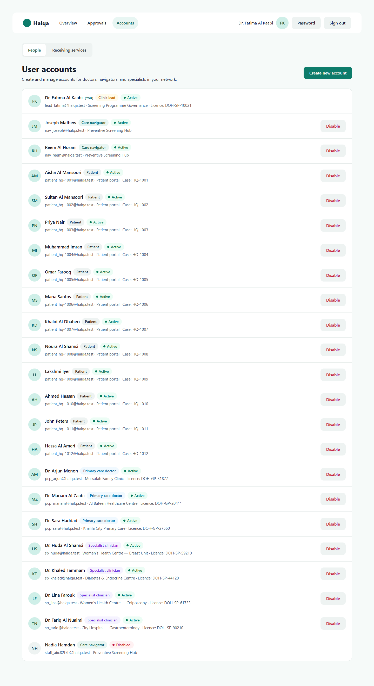

### Add and disable a receiving service
A receiving service is a hospital unit or clinic that accepts referrals for one care programme and is answered by one specialist account. A doctor can only send a referral to a service listed here, so a programme with no active service cannot send referrals at all. Clinic Leads manage them on the **Accounts** screen:
1. Open the **Accounts** tab, then choose **Receiving services** at the top of the screen (the other choice, **People**, is the account list).
2. Each service shows the name of the unit, the programme, the specialty, **Answered by** the specialist, and a word: **Active** or **Disabled**.
3. **Add one:** press **Add a receiving service**. Fill in **Name of the unit** (the name doctors will see), **Specialty**, **Care programme** and **Specialist who answers**, then press **Add service**. If the list of specialists is empty, the screen asks you to add a specialist account first on the **People** tab. If that unit already has a service for that programme, the screen says so and stays open so you can change the details.
4. **Disable one:** press **Disable** on the service, read the message, then press **Disable service** (or **Not now** to keep it). New referrals to that unit are refused from then on. Referrals already sent stay as they are. A disabled service has no button.
5. Doctors see the change within a few seconds, the next time their screen refreshes.

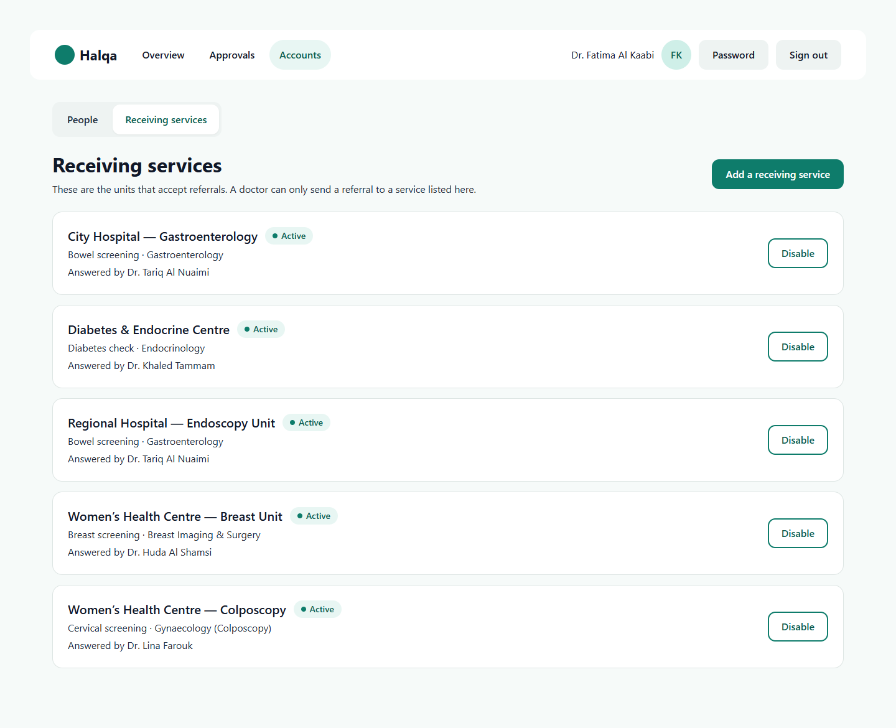

---

## 6. Patient Portal Guide

The Halqa Patient Portal runs directly on patients' mobile phones (optimized for 320px and 390px screens). It is available in English, Arabic (`ar`), Hindi (`hi`), and Urdu (`ur`) with full right-to-left layout support.

### 1. Your Result (P1)
- Clear, plain-language notification of their screening result.
- Avoids medical jargon or alarming language.
- One clear call to action: **Next step**.

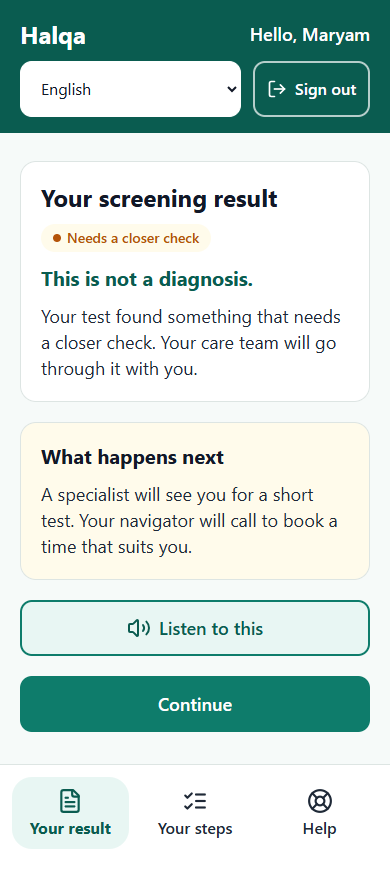

### 2. Quick Check (P2)
- Helps patients confirm they understand what the result means before booking.
- Two simple, supportive questions.
- Confidence rating slider (1 to 5).
- If a patient expresses low confidence, their care navigator is automatically alerted to provide proactive phone guidance.

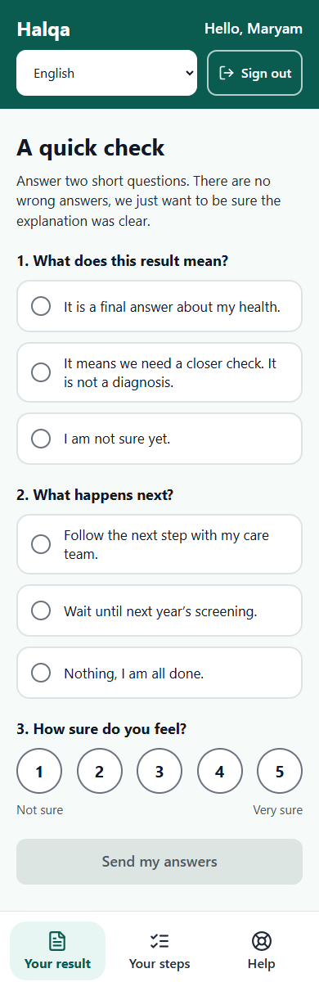

### 3. Your Steps & Booking (P3 & P4)
- Shows the patient what to expect next at each stage of their care.
- Once the specialist has accepted the referral, the screen says "Your navigator will call you to book a time." The patient does not pick a time; the navigator or doctor enters the real appointment on the case page. When an appointment exists, the screen shows the day, time and place, with "Add to my calendar" and a way to ask for a change.
- Automatically generates standard `.ics` calendar appointments with one click.

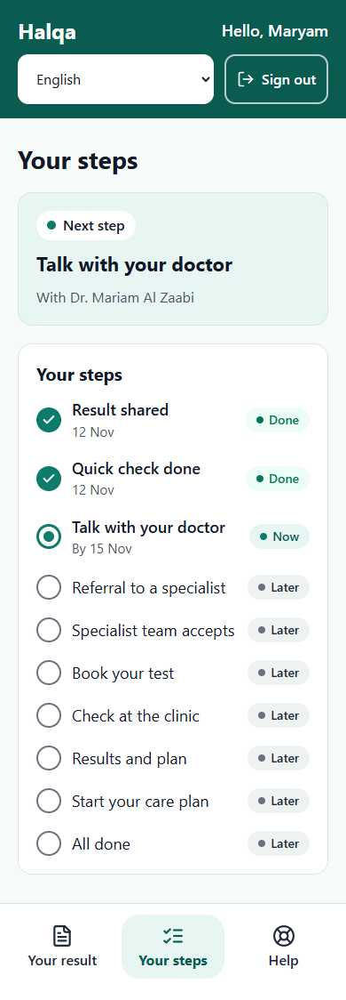

### 4. Help and Questions (P6)
- Patients can submit questions to their care team at any time.
- Request a callback with a single tap.
- Request a language interpreter in their preferred language.

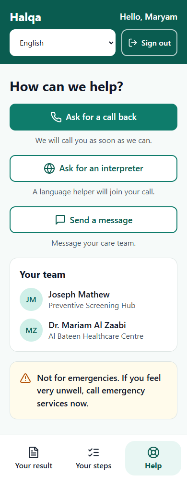

### 5. Multilingual & RTL Support (P9)
- Fully translated into Arabic and Urdu with native right-to-left alignment, fonts, and reading flow.

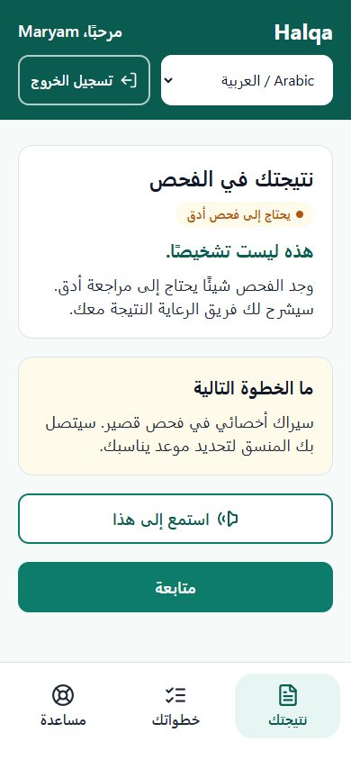
