# Halqa User Guide

Halqa connects screening programmes with timely clinical follow-up across primary care, specialist clinics, and patients.

This guide explains everyday tasks for each role.

---

## 1. Getting Started

### Signing In
Staff sign in using their clinic email address and password at the sign-in screen.
- First-time sign in: If your account has a temporary password, Halqa will ask you to set a new password before you continue. Passwords must be at least 12 characters long.
- Password updates: You can update your password at any time with the **Password** button in the top bar.

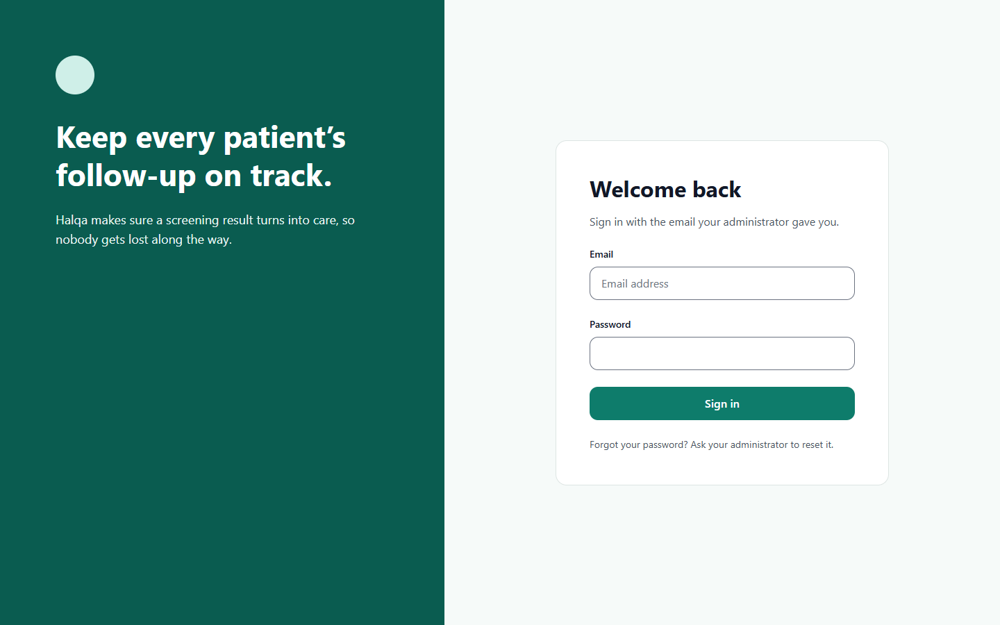

### Your Workspace and Role Tabs
When you sign in, Halqa automatically opens your primary workspace:
- Care navigators and primary care doctors open **My work**.
- Specialists open **Referrals**.
- Clinic leads open **Overview**.

Tabs are displayed clearly at the top:
- **My work:** Action-ranked cases needing attention.
- **Referrals:** Incoming and active specialist consultations.
- **Overview:** Clinic-wide performance and follow-up metrics.
- **Approvals:** Exception requests requiring two-person clinical review.
- **Accounts:** (Clinic Leads only) Staff directory, account creation, and credential management.

---

## 2. Care Navigator Guide

Navigators explain screening results, check understanding, arrange interpretation, and follow up on delays.

### Reviewing Your Cases
**My work** groups open cases by whether they need action now, are late or due soon, or are waiting for someone else. Open a case to see the next step, who owns it, and its due time.

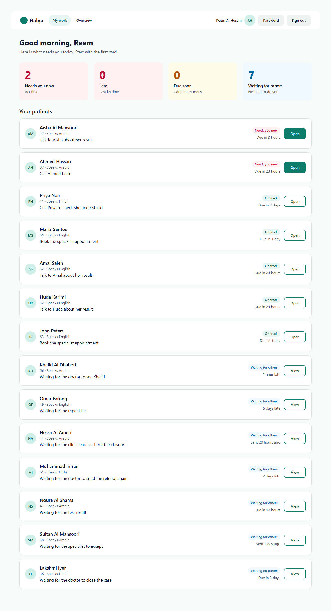

### Opening and Managing a Case
Click **Open** on any case card to open the case workspace. Dates and times are shown in the clinic's time zone, set with `NEXT_PUBLIC_HALQA_TIME_ZONE` (for example `Asia/Dubai`); when it is not set, the time zone of the browser is used.

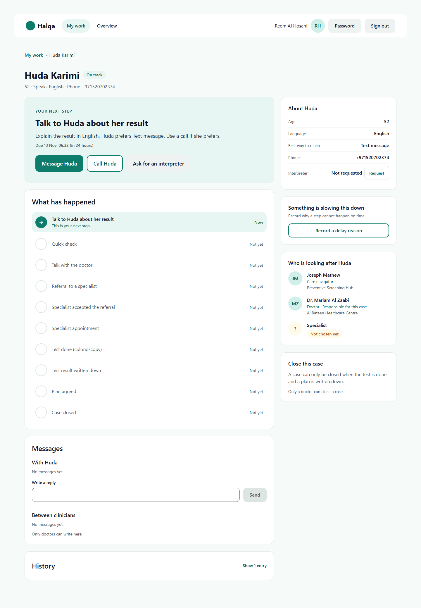

Key navigator actions on the case page:
1. **Your next step card:** Displays the immediate action required. The buttons depend on the step. **Mark as done** records a step that needs a note (the note box appears only for those steps). On the first step the main button is **Message <first name>**, because it queues a message for the patient. The case page then says "Message is waiting to be delivered" and the step is only done when the message service reports that it arrived (until then you can still phone the patient); **Call <first name>** records a phone call (reached or no answer). **Ask for an interpreter** records the request. When the specialist has accepted the referral, the card asks for the date and time of the appointment: type the real date and time agreed with the clinic. No times are suggested for you.
2. **About the patient:**
   - Displays patient contact information, preferred language, and clinical programme.
   - **Language interpreter request:** If the patient requires language support, click **Request** under Interpreter. Toggle **Turn off** once support is arranged or no longer needed.
3. **Recording delays ("Something is slowing this down"):**
   - Click **Record a delay reason**.
   - Select the cause:
     - *Could not reach the patient*
     - *Missed appointment*
     - *Specialist sent referral back*
     - *Clinic or hospital is busy*
     - *Patient had questions or needed more time*
     - *Patient wants to pause or decline*
     - *Patient is travelling*
     - *Waiting for records or test results*
   - Enter context in the optional note field and click **Save reason**. The reason is immediately visible to the entire clinical team.
4. **Patient callbacks:**
   - If a patient requests a phone call via their portal, an alert appears under **Needs you now**.
   - Once you have called the patient, record the callback and note any questions answered.

---

## 3. Primary Care Doctor Guide

Primary care physicians provide clinical consultations, place specialist referrals, review completed findings, and formally close completed screening pathways.

### Conducting Consultations
1. Open the patient's case from **My work**.
2. Review the screening result, history, and patient questions.
3. Record your consultation findings:
   - If no further specialist care is required, prepare the case for closure.
   - If specialist evaluation (e.g. colonoscopy, colposcopy, biopsy) is indicated, initiate a specialist referral.

### Referring to a Specialist
1. On the case page, select the required specialty service from the directory.
2. Enter the clinical reason for referral and any required priority.
3. Confirm the referral. The case immediately appears in the receiving specialist's **Referrals** inbox.

### Closing a Case with Evidence

1. Click **Close case** and check the **Before you close** list.
2. Enter what the test showed, the report reference, and the follow-up plan. Add a next screening date if applicable.
3. Click **Close case** to record the decision. Halqa gets the clinician's name and licence from the signed-in account.

### Requesting an Exception Close
If the patient declined, received care elsewhere, or moved out of scope, choose the matching option under **How is this case ending?** Enter the outcome, evidence reference, plan and the reason for requesting closure without a test. Click **Close case** to send the request for a second check. The case stays open until the clinic lead approves it.

---

## 4. Specialist Guide

Specialists review incoming referrals, then record test results and care plans for the referring doctor.

### Reviewing Incoming Referrals
1. Click the **Referrals** tab.
2. Review new referrals in the **Incoming** queue.

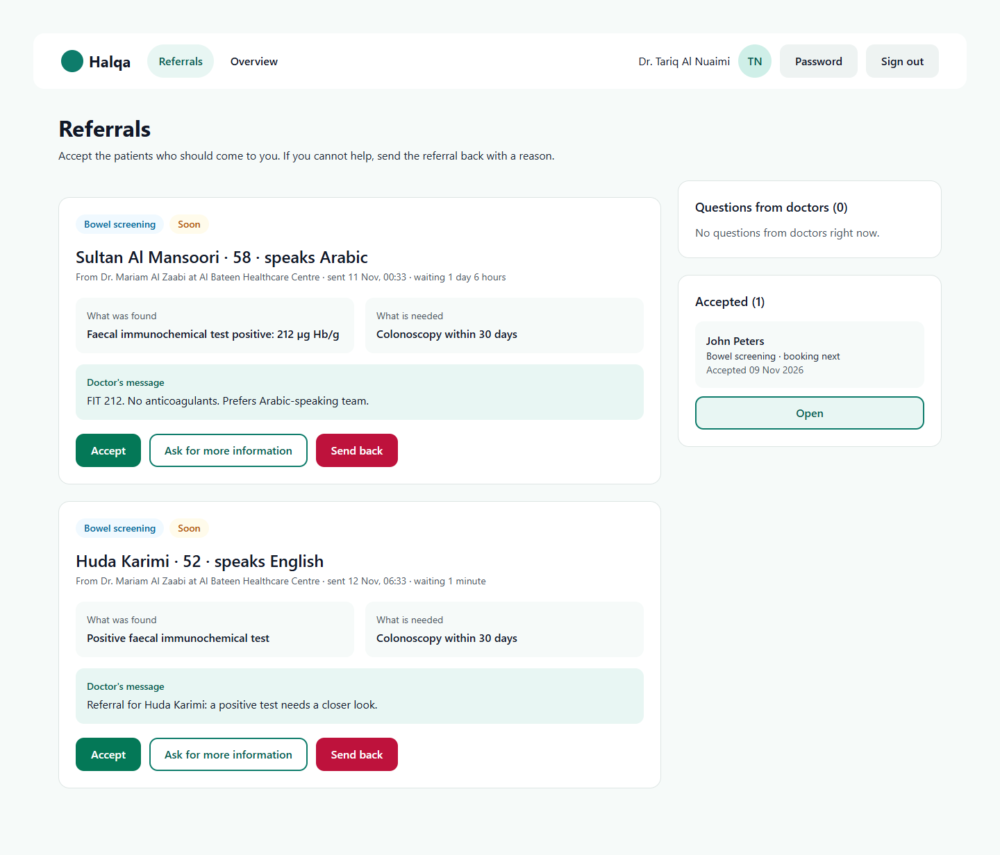

3. Actions:
   - **Accept** lets the care team book an appointment at the receiving service.
   - **Ask for more information** sends the referring doctor a question.
   - **Send back** returns the referral to the doctor with the selected reason.

### Documenting Attendance and Outcomes
1. Record when the patient attends the specialist appointment.
2. Document the procedure findings, outcome, and post-procedure care plan.
3. Record the care plan in the case. The referring doctor can see the result and plan when reviewing closure.

---

## 5. Clinic Lead Guide

Clinic Leads oversee programme performance, review exceptions, and manage staff accounts.

### Monitoring Clinic Overview
The **Overview** dashboard shows the typical time to tell a patient their result, tests done on time, cases closed with test evidence, and patients who understood their result. The breakdown shows performance by programme and the most common recorded delays.

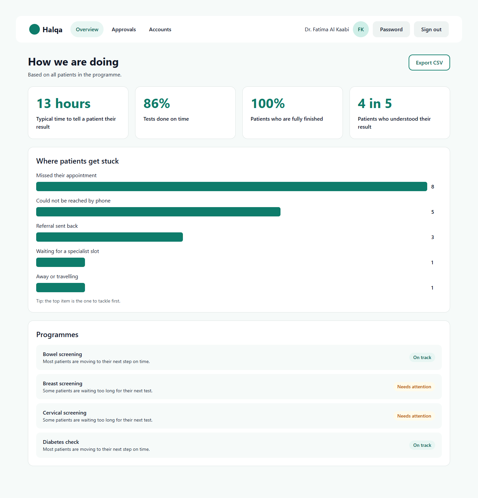

### Approving or Rejecting Exceptions
To maintain clinical safety, exceptions cannot be closed by a single clinician.
1. Open the **Approvals** tab.
2. Review pending requests.
3. Verify counseling notes and clinical reasoning.
4. Write a decision note and select **Approve** or **Send back to the doctor**.

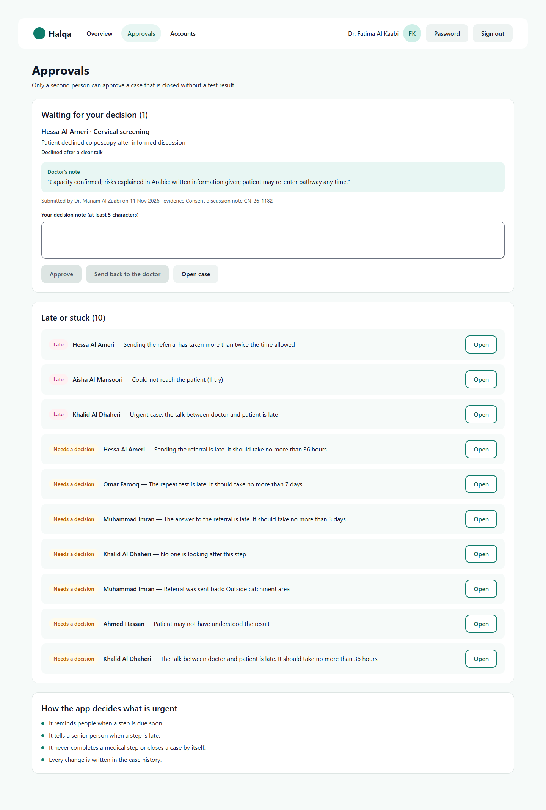

### Managing Staff Accounts
Clinic Leads manage staff accounts directly through the **Accounts** screen without database manipulation:
1. Open the **Accounts** tab.
2. **Review existing accounts:** View names, roles, emails, and account status (active or disabled).
3. **Add a new staff member:**
   - Enter name, email, and assign role (`NAVIGATOR`, `PCP`, `SPECIALIST`, `LEAD`).
   - Click **Create account**.
   - A one-time temporary password is generated. Share this securely with the staff member. They will be required to change it upon first sign-in.
4. **Disable accounts:** Click **Disable** next to any departing staff member to immediately revoke session access.

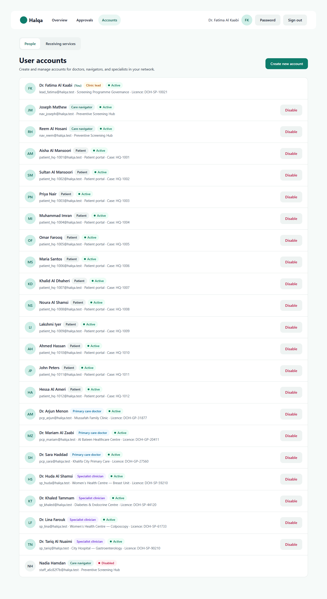

### Add and disable a receiving service
A receiving service is a hospital unit or clinic that accepts referrals for one care programme and is answered by one specialist account. A doctor can only send a referral to a service listed here, so a programme with no active service cannot send referrals at all. Clinic Leads manage them on the **Accounts** screen:
1. Open the **Accounts** tab, then choose **Receiving services** at the top of the screen (the other choice, **People**, is the account list).
2. Each service shows the name of the unit, the programme, the specialty, **Answered by** the specialist, and a word: **Active** or **Disabled**.
3. **Add one:** press **Add a receiving service**. Fill in **Name of the unit** (the name doctors will see), **Specialty**, **Care programme** and **Specialist who answers**, then press **Add service**. If the list of specialists is empty, the screen asks you to add a specialist account first on the **People** tab. If that unit already has a service for that programme, the screen says so and stays open so you can change the details.
4. **Disable one:** press **Disable** on the service, read the message, then press **Disable service** (or **Not now** to keep it). New referrals to that unit are refused from then on. Referrals already sent stay as they are. A disabled service has no button.
5. Doctors see the change within a few seconds, the next time their screen refreshes.

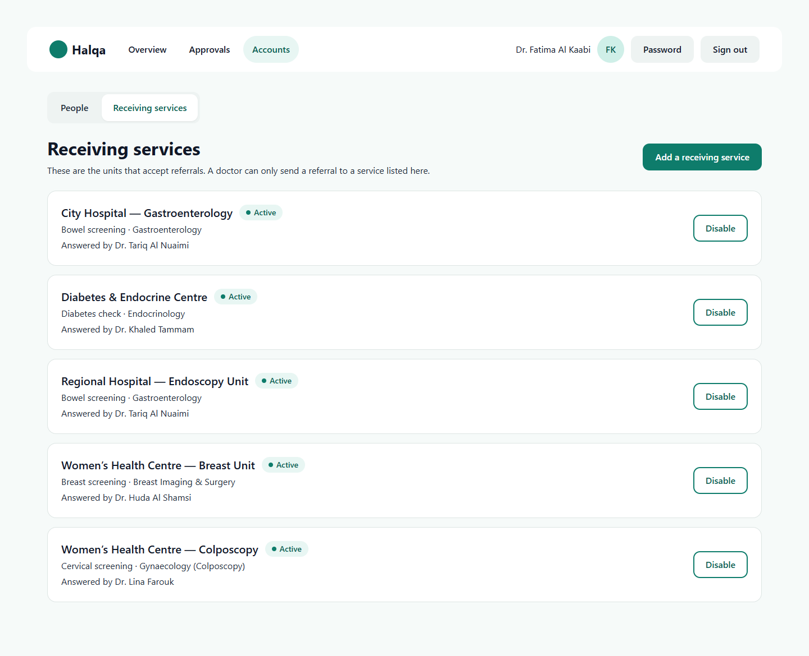

---

## 6. Patient Portal Guide

Patients can open the portal in a mobile browser. It is available in English, Arabic, Hindi and Urdu. Arabic and Urdu use a right-to-left layout.

### 1. Your Result (P1)
- Clear, plain-language notification of their screening result.
- Avoids medical jargon or alarming language.
- Choose **Continue** to move to the quick check.

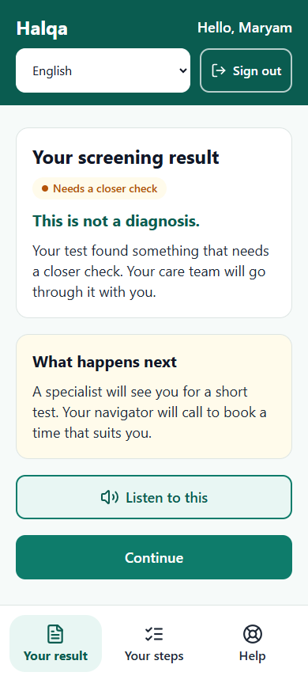

### 2. Quick Check (P2)
- Helps patients confirm they understand what the result means before booking.
- Two simple, supportive questions.
- Choose a confidence rating from 1 to 5.
- An incorrect answer or low confidence alerts the navigator to follow up.

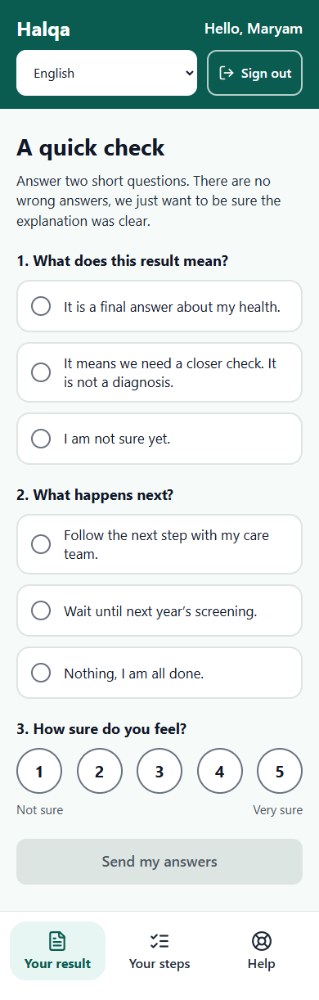

### 3. Your Steps and Booking
- Shows the patient what to expect next at each stage of their care.
- Once the specialist has accepted the referral, the screen says "Your navigator will call you to book a time." The patient does not pick a time; the navigator or doctor enters the real appointment on the case page. When an appointment exists, the screen shows the day, time and place, with "Add to my calendar" and a way to ask for a change.
- Automatically generates standard `.ics` calendar appointments with one click.

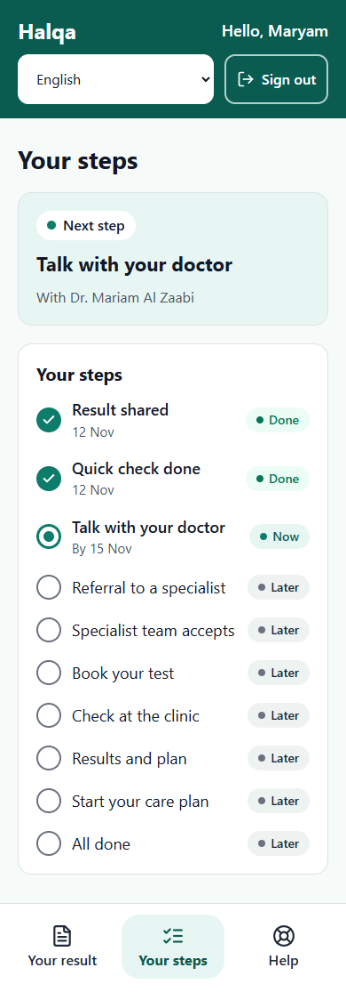

### 4. Help and Questions (P6)
- Patients can submit questions to their care team at any time.
- Request a callback with a single tap.
- Request a language interpreter in their preferred language.

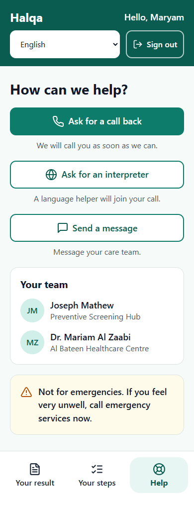

### 5. Multilingual & RTL Support (P9)
- Fully translated into Arabic and Urdu with native right-to-left alignment, fonts, and reading flow.

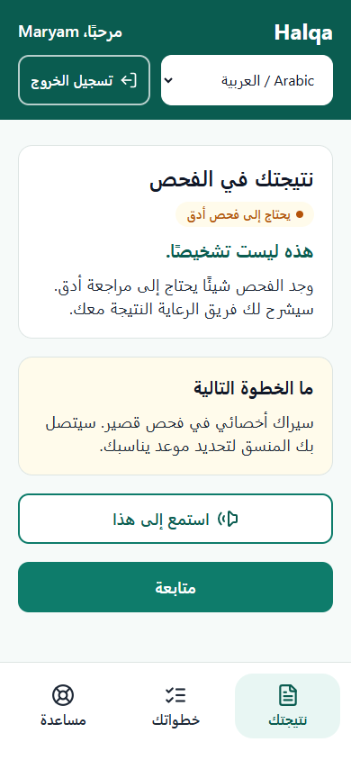
